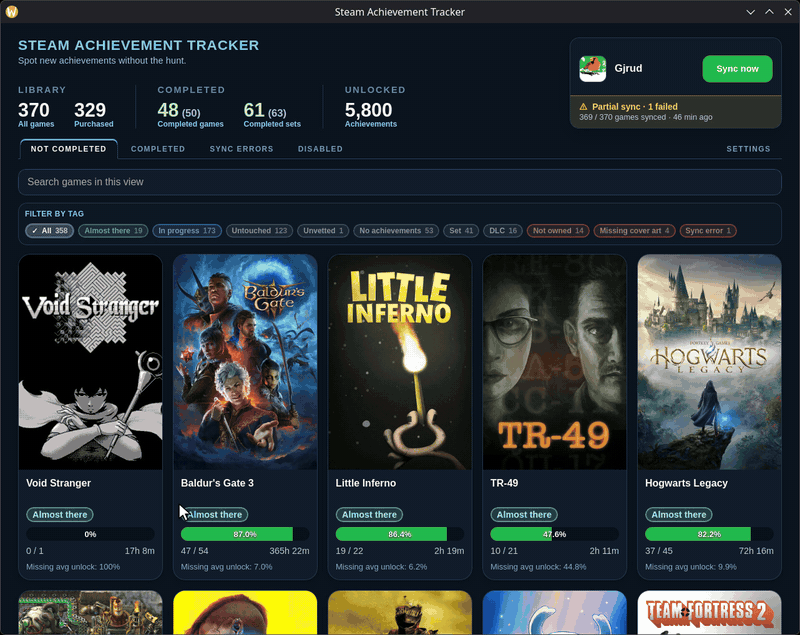

# Steam Achievement Tracker

[](LICENSE)
[](go.mod)
[](#requirements)
[](https://github.com/gjrud/steam-achievement-tracker/actions/workflows/ci.yml)
[](https://github.com/gjrud/steam-achievement-tracker/actions/workflows/github-code-scanning/codeql)
[](https://github.com/gjrud/steam-achievement-tracker/releases)

Steam Achievement Tracker is a Linux and Windows desktop app that tracks your Steam achievement progress. It reads your Steam profile and keeps the results on your computer. It highlights games worth finishing next and makes sync problems visible instead of silently losing old data.

I built this app for personal use, entirely through vibecoding. I have entry-level knowledge of Go, which I often use for personal or work-related CLI tools, but the Svelte/JavaScript frontend is far outside my area of expertise.

## Features

- **Profile setup** from a SteamID64, a profile URL, or a vanity name. The profile is checked before it is saved.
- **Secure key storage**: your Steam Web API key is kept only in the system keyring.
- **Automatic and manual sync** of your library, playtime, purchase status, achievements, and cover images from Steam.
- **Dashboard** with counters for games, purchased games, completed games and sets, and unlocked achievements, plus a profile card with the latest sync status.
- **Not completed** view: games ranked by how close they are to being finished, with search and tag filters.
- **Completed** view: achievement sets that are fully unlocked.
- **Sync errors** view: games whose latest refresh failed. Earlier data is kept.
- **Disabled** view: games you disabled, and games the profile no longer owns.
- **Achievement sets**: each set of a game (base game, named sets, DLC sets) is its own card, completed and disabled on its own.
- **Per-set actions**: mark as previously completed, flag missing achievements as DLC-related, disable or re-enable.
- **Library sync options** for unvetted apps and played free-to-play games, per profile.
- **Remove profile** from Settings. By default, this only disconnects the profile and keeps its data. You can also delete the data and the saved API key.
- **Local storage** in SQLite, with a backup before database upgrades, and rotating log files.

## Requirements

### Linux requirements

- A Linux desktop session with the GTK 4 and WebKitGTK 6.0 runtime libraries. The deb, rpm, and Arch packages install them as dependencies. If the AppImage fails to start, install the GTK 4 and WebKitGTK 6.0 runtime packages. On Debian and Ubuntu the packages are `libgtk-4-1` and `libwebkitgtk-6.0-4`.
- A Secret Service provider such as GNOME Keyring, unlocked while you use the app. The packages do not install one.

### Windows requirements

- Windows 10 or Windows 11, 64-bit (amd64). Windows Credential Manager is built in.
- Microsoft Edge WebView2 Runtime. Windows 11 includes it, and the setup installer adds it on Windows 10 when it is missing. The portable exe installs nothing. On Windows 10 the app may not start until the [WebView2 Runtime](https://developer.microsoft.com/microsoft-edge/webview2/) is installed, so install it first.

### Both systems

- A Steam Web API key (see [Get a Steam Web API key](#get-a-steam-web-api-key)).
- Network access to Steam's Web API and Steam's image servers.
- Your own Steam profile, from the account that owns the API key. It can have any privacy setting, including private.

## Install

### Linux install

Download a package for your distribution (deb, rpm, or Arch `pkg.tar.zst`) or the AppImage from the [GitHub Releases](https://github.com/gjrud/steam-achievement-tracker/releases) page. Each release lists `SHA256SUMS` for its files.

The packages install the program, a menu entry, and app icons. The window and taskbar use the icon from that menu entry. The AppImage cannot install the menu entry itself, so on KDE its window title bar may show a generic icon.

Removing the package removes only the program files. Your data, cache, logs, and saved API key stay (see [Data and privacy](#data-and-privacy)).

### Windows install

Each release has two amd64 files:

- `steam-achievement-tracker-<version>-windows-amd64-setup.exe`: a per-user installer. It needs no administrator rights, installs to `%LocalAppData%\Programs\Steam Achievement Tracker` and adds a Start Menu shortcut (no desktop icon). Uninstalling removes the program files and shortcut, but keeps your data, cache, and saved API key.
- `steam-achievement-tracker-<version>-windows-amd64-portable.exe`: runs without installing. It uses the same data folder as the installer, so you can switch between the two.

The Windows builds are not code-signed. SmartScreen warns about unsigned apps until the downloads build reputation, and may show "Windows protected your PC". Choose **More info**, then **Run anyway**. To check a file first, compare its hash with `SHA256SUMS` on the release page. In PowerShell:

```powershell
Get-FileHash .\steam-achievement-tracker-<version>-windows-amd64-setup.exe -Algorithm SHA256
```

On Linux, run `sha256sum --check --ignore-missing SHA256SUMS` in the folder that holds the downloaded files. The file lists every release asset, so `--ignore-missing` skips the ones you did not download.

### Get a Steam Web API key

1. While signed in to Steam, open <https://steamcommunity.com/dev/apikey>. The setup screen's **Get a Steam Web API key** link opens the same page.
2. When Steam asks for a domain name, enter `localhost`.
3. Start the app, paste the key on the setup screen and click **Save key**. Saving does not start a sync.

The app stores the key in the system keyring under service `steam-achievement-tracker` and user `steam-web-api-key`:

- **Linux:** the Secret Service keyring. It may ask you to unlock it first.
- **Windows:** Windows Credential Manager, as a generic credential named `steam-achievement-tracker:steam-web-api-key`. View or delete it under **Credential Manager** > **Windows Credentials** > **Generic Credentials**.

### Launch

On Linux, start `steam-achievement-tracker` from your menu or a terminal. On Windows, use the Start Menu or run the portable exe. If no key is stored, the app opens the key setup screen. **Retry key lookup** checks the keyring again, which helps if you stored the key another way.

## Usage

### Change the API key

To enter your first key, see [Get a Steam Web API key](#get-a-steam-web-api-key). You cannot change the key in Settings. If no profile is active, the profile setup screen has a **Replace key** button. Once a profile is connected, remove it with **Delete API key** (see [Remove the active profile](#remove-the-active-profile)), enter the new key, then connect the profile again. Its data is kept unless you also chose **Delete profile data**.


### Connect a Steam profile

On first launch, if a key is saved and no profile is active, enter one of:

- A SteamID64, such as `7656119...`
- A profile URL with its scheme, such as `https://steamcommunity.com/profiles/<steamid64>`
- A vanity URL with its scheme, such as `https://steamcommunity.com/id/<name>`
- A vanity name on its own

Click **Validate** to see the Steam name and avatar the app found. Click **Save and sync** to make the profile active and start a sync. Only one profile can be active at a time.


### Sync

A sync starts when you save a profile, when the app starts with a profile and key, or when you click **Sync now**. While it runs, the button reads **Syncing…** and the dashboard refreshes as the sync progresses.

- Games that Steam no longer lists for the profile are disabled for that profile. A game you disabled yourself stays disabled, even if Steam lists it again.
- Each achievement set of a game gets its own card. Achievements that Steam marks as archived are not counted.
- DLC sets stay in the list even when you do not own the DLC. They are tagged **Not owned**.
- If one game fails, the rest of the sync continues. The failed game keeps its previous data, appears in **Sync errors**, and the run is reported as partial.
- If the app closes during a sync, the sync stops and its run is recorded as failed. Games that were not finished keep their previous data. **Sync canceled** appears only for a run that never recorded its end, such as after a crash or power loss. The next start marks such a run canceled.

Steam limits how quickly the app can request data. The app fetches up to four games at a time and retries requests when Steam returns a temporary error, so syncing a large library takes a while.

### Dashboard

The header shows the profile card and five counters, grouped into three sections:

- **Library**: **All games** (games that are not disabled, including free-to-play games you have played) and **Purchased** (games that are not disabled and are in your account's purchased list). Played free-to-play games are not included in **Purchased**. Steam's purchased list may also include free license grants.
- **Completed**: **Completed games** (games whose base set is complete; a game with only a completed DLC set does not count) and **Completed sets** (completed base, named or DLC sets, each counted separately).
- **Unlocked**: **Achievements**, the unlocked achievements in games that are not disabled.

If some counted games or sets are unvetted (see [Library sync options](#library-sync-options)), a completed counter shows the vetted count followed by the total, such as `12 (15)`. The vetted count appears in green.

The profile card shows your avatar, name, and the **Sync now** button. Below the button, the sync band shows the latest sync:

- **Green**, with a check mark: all games synced.
- **Amber**, with a warning: partial sync, with the number of failed games.
- **Red**, with a warning: sync failed, with the number of errors when there are any.
- **Blue**, with a spinner: a sync is running, shown as games synced out of games in the library.
- **Grey**: no sync yet, or the last sync was canceled.

Below the headline, the dashboard shows the game counts and how long ago the sync finished, such as "5 min ago" or "2 hours ago". After seven days, it shows the date and time instead. While a sync runs, it shows `Started <time>` using the start time. Each state has an icon and text, so colour is not the only signal.

The main tabs are **Not completed**, **Completed**, **Sync errors**, **Disabled** and **Settings**. On a narrow window the header stacks and the tabs wrap.

### Not completed

This view lists games that are not yet complete. Each card shows progress, playtime, and tags, plus cover art when cached. When Steam provides the data, it also shows the average unlock rate for the achievements you are missing.


Search filters by title. Select a tag chip to show only matching cards; each chip shows how many cards match.

### Completed

The **Completed** tab lists games and sets with all known achievements unlocked. Search and tag chips work the same way as in **Not completed**.


### Sync errors

This tab lists games whose latest refresh failed. The app shows previous data when available. Use **Disable** to hide a game that keeps failing. Right-click a row to mark the game as previously completed, flag its missing achievements as DLC-related, or disable it.


### Disabled

This tab lists games you disabled and games the profile no longer owns. Click **Re-enable** to bring a game back.

### Achievement sets

Steam groups achievements into sets. A game with DLC or multiple sets (such as Team Fortress 2's class sets) gets one card per set:

- A set is completed on its own. A completed set moves to **Completed**, and its unfinished siblings stay in **Not completed**.
- Unnamed sets are named after the game, for example `Team Fortress 2 – Scout`. A card for a set other than the base set has the **Set** tag, and a card for a DLC set has the **DLC** tag.
- A DLC set you do not own is tagged **Not owned**. It has no progress, and its achievements are left out of the dashboard counters. The next sync after you buy the DLC removes the tag.
- Sets show the same playtime as their game, because Steam reports playtime per game.
- Sets without achievements are not shown.

Search matches the game name and lists all of that game's set cards. Disable and re-enable affect one card at a time. If every set of a game is disabled, the app skips that game during sync. New DLC sets appear only after you re-enable one of its sets.

### Cover art

The app downloads cover images from Steam's image servers to its cache folder. A base game uses the library image from your owned-games data. DLC sets and games without that image use other images Steam lists for the app. A DLC set without its own image uses its parent game's cover. If Steam has no cover, the app checks again after 7 days. Until a cover downloads, the card shows the title's first letter and **Missing cover art**.

### Tags and sorting

The **Not completed** list ranks games by how close they are to completion:

1. Games with achievements that are not flagged as DLC-related. Games flagged **New achievements added** come first.
2. DLC sets you do not own (**Not owned**), sorted by title. These never rank above a real candidate.
3. Games flagged **Achievements in DLC**, sorted by suggestion score.
4. Games with no Steam achievements, sorted by title.

Within the first group, games are sorted by suggestion score, highest first. The score uses your completion percentage and, when Steam provides it, the average unlock rate for the achievements you are missing.

| Tag | Meaning |
| --- | --- |
| **New achievements added** | The game was complete before, but Steam has added locked achievements since. Incomplete cards only. |
| **Almost there** | The game has playtime and its suggestion score is 40 or higher. |
| **In progress** | The game has playtime, and its suggestion score is below 40. |
| **Untouched** | The game has no recorded playtime. |
| **Unvetted** | Steam has not vetted the app yet. Appears on games synced while **Include unvetted apps** was on: every card of such a game, including set and DLC cards and completed cards, has it and can be filtered by it. The next sync after Steam vets the app clears it. A game that leaves the library keeps its last known vetted state, so it may still show the tag in **Disabled**. |
| **No achievements** | Steam reports no achievements for the game. |
| **Set** | The card is an achievement set other than the game's base set. |
| **DLC** | The set belongs to a DLC. |
| **Not owned** | The set belongs to a DLC you do not own. It has no progress tags. |
| **Achievements in DLC** | You flagged the remaining achievements as DLC-related. Incomplete cards only. |
| **Missing cover art** | No cover is cached. A DLC set counts as covered when its parent game is. |
| **Sync error** | The latest refresh of this game failed. |
| **Completed** | Shown on completed cards. |

Filter chips and card tags follow this table's order. On completed cards, **Completed** appears first but has no filter chip. A view shows chips only for tags used by at least one card. Changing tabs clears the selected chip, but search still applies.

### Right-click actions

Right-click a game card or a row in **Sync errors** to open its menu:

- **Disable game** or **Disable set** hides it from the active views and totals, and skips it during sync. Re-enable it from **Disabled**.
- **Mark as previously completed** is for a game that was complete before Steam added more achievements. It adds the **New achievements added** tag while the game is incomplete.
- **Flag missing achievements in DLC** is for remaining achievements that belong to DLC or to content you do not plan to count. It adds the **Achievements in DLC** tag.

These flags are local bookkeeping stored on your computer for each profile. You can clear either flag from the same menu.




### Library sync options

In **Settings**, choose what to load when syncing the active profile. Each profile has its own settings; both options are on for a new profile:

- **Include unvetted apps**: includes new Steam apps that Steam hides until it vets them. Those games are tagged **Unvetted** and counted separately in the **Completed** counters. With the option off, every game counts as vetted.
- **Include played free games**: includes free-to-play games you played without buying. With the option off, only purchased games are tracked, and **Purchased** equals **All games**.

Changes take effect on the next sync and do not start one. Turning an option off removes the games it excludes during that sync, so they may appear in **Disabled** as no longer owned.

### Remove the active profile

In **Settings**, use **Remove profile** in the **Remove active profile** section. Before enabling the button, the dialog asks you to type the value shown (the profile's SteamID64). Two switches, both off by default, let you choose what else to delete:

- **Delete profile data** deletes the profile's games, playtime and purchase status, achievements, sync history, manual flags, tags, library sync settings and cached covers.
- **Delete API key** deletes the Steam Web API key from the system keyring. The app then shows the key screen, and sync stays unavailable until you enter a key again.

The confirm button describes what will be deleted, such as **Remove profile and data**. Neither switch deletes log files (see [Log files](#log-files)).

If both switches are off, the app only disconnects the profile. Its data stays on disk and the key is kept. Connecting the same SteamID64 again restores the data and starts a sync. Disconnected profile data stays on disk until you reconnect that profile and remove it with **Delete profile data**. If you deleted the profile data, reconnecting starts with both library sync options on.


## Data and privacy

The app stores its files in three folders for your user account. Each folder ends in `steam-achievement-tracker`. The environment variables `XDG_DATA_HOME`, `XDG_CACHE_HOME`, and `XDG_STATE_HOME` change the base folders on both systems.

| Folder | Linux | Windows | Holds |
| --- | --- | --- | --- |
| Data | `~/.local/share/steam-achievement-tracker/` | `%LocalAppData%\steam-achievement-tracker\` | The database and its backups |
| Cache | `~/.cache/steam-achievement-tracker/` | `%LocalAppData%\cache\steam-achievement-tracker\` | Cover images. On Windows also the WebView2 browser profile (`webview/`) |
| State | `~/.local/state/steam-achievement-tracker/` | `%LocalAppData%\steam-achievement-tracker\` | Log files (`logs/`) |

On Windows, the data and state folders are the same. The **Settings** screen shows the data, cache, and log folders, along with the current log file.

The folders are created for your user only. Windows does not use Linux permission bits; it relies on your user profile's permissions instead.

You can delete the cache at any time. The next sync downloads the covers again; until then, the cards show placeholders.

Your Steam Web API key is stored only in the system keyring, not in these folders (see [Get a Steam Web API key](#get-a-steam-web-api-key)). The app deletes that keyring item only when you choose **Delete API key**.

### Where your data stays

All your data stays on your computer: profiles, library, achievements, sync history, settings, and logs. The app never sends this data to the developer or any other service. It has no accounts, telemetry, or analytics.

The app connects only to Steam:

- **Steam's Web API** (`api.steampowered.com`). Your API key is sent only to the requests that need it, to find your profile and read your games and achievements.
- **Steam's CDN**, for cover art and profile avatars.

The only other network action is the **Get a Steam Web API key** link. It opens Steam's key page in your default browser; your browser loads the page, not the app.

Your API key is never written to the database, the log files or error messages.

### What is stored in the database

The database file is stored in the data folder. It contains:

- For each connected profile: the SteamID64, the Steam display name and the avatar URL.
- Your owned games, playtime and purchase status. Game names, achievement API names, Steam's global unlock percentages, and your unlock state and unlock time for each achievement.
- Your choices: the previously completed, missing-DLC and disabled flags, the library sync options, and the dashboard tags.
- The sync history: when each sync ran, its status and any error message.
- The cover records: the cover file name, the Steam URL it came from and when it was checked. The database stores no file paths.
- The active profile.

The vanity name or profile URL you enter during setup is used once to look up your SteamID64, then discarded.

### Log files

Log files are in the `logs` folder inside the state folder. The current file is `app.log`. When it reaches 5 MB, it is rotated: the 5 newest old files are kept and older ones are removed. Old files are not compressed. Logs record app events, sync warnings, and errors, mostly by Steam app ID. The API key is always removed from these messages. The SteamID64 and vanity name are also removed from the request address that a failed Steam request can include in an error, so new log lines do not contain them. Log lines can still include Steam's raw response text, the app ID, and database or system keyring error text. A file-system error (`*fs.PathError` or `*os.LinkError`) is logged with its paths reduced to file names; a path that appears inside other error text is not removed. Steam's own error text never reaches the app screens or the stored sync history; it is logged only. Errors shown in the app and saved for display are short plain-language messages instead (for example "Steam is temporarily unavailable. Try again later." or "Something went wrong. See the log file for details."): the per-game message in the Sync errors view, the sync run's error, which is stored and exposed in the app state, and the messages of the bound actions and the startup screen. They do not carry the raw Steam response, a file path, SQL, or keyring backend text. To remove log lines, delete the `logs` folder (see below). **Delete profile data** removes the sync history with the profile's data.

### Sharing and erasing your data

Before sharing the database, a log file, or a screenshot (for example, in a bug report), check for your display name, SteamID64, and avatar. Remove or blur them.

To erase a profile in the app, use **Remove profile** (see [Remove the active profile](#remove-the-active-profile)). **Delete profile data** removes the data that only that profile uses. **Delete API key** removes the key from the keyring. Neither one deletes log files. Logs rotate at 5 MB and the 5 newest old files are kept. To remove all of them, delete the `logs` folder in the state folder.

To erase everything, close the app and delete the data, cache, and state folders listed above. On Windows, the data and state folders are the same. If you did not use **Delete API key**, also remove the `steam-achievement-tracker` item from your keyring (Secret Service on Linux, Credential Manager on Windows).

Before a database upgrade, the app copies the database to the `backups` folder inside the data folder. The app never reads or deletes these backups. A backup made before the upgrade that removed stored cover file paths still contains those paths, including your user name. A backup made before the upgrade that rewrote stored sync error text still holds the old text, which can include a request address with your SteamID64; the app does not display it. Delete any backups you do not need from `backups`. This does not affect the current database.

## Troubleshooting

- **"No Steam profile was found for that account.", a profile link error, or a vanity name error**: check the SteamID64, profile link, or vanity name. A link must include its scheme, such as `https://`, and contain `steamcommunity.com/profiles/<number>` or `steamcommunity.com/id/<name>`. Without the scheme, the app treats the text as a vanity name, which fails.
- **Sync fails or the profile shows no games**: make sure the profile is yours and belongs to the account that owns the API key. Any privacy setting works.
- **"Steam Web API key missing"**: enter the key on the setup screen. If you stored it outside the app, click **Retry key lookup**.
- **The key does not save on Linux**: unlock your Secret Service keyring and try again. If you dismissed the unlock prompt, the app reports that it did not store the key instead of reporting success.
- **Startup error screen**: the message names the problem and shows the log file. The log has the details.
- **Portable exe does not start on Windows 10**: install the WebView2 Runtime first (see [Windows requirements](#windows-requirements)).
- **SmartScreen warning on Windows**: see the note in [Windows install](#windows-install).
- **Covers are blank**: they download on the next sync. If Steam has no image for a game, the card keeps the placeholder.
- **Sync failed or partial**: open the **Sync errors** tab to see which games failed. The next sync retries them.
- **A game is missing**: check whether it is disabled, whether **Include played free games** or **Include unvetted apps** is off, and whether Steam still lists it for the profile.

Find the log file in the state folder listed in [Data and privacy](#data-and-privacy).

## For developers

See [docs/](docs/README.md) for developer documentation on the architecture, Go packages, database, sync logic, frontend, tests, and build and release process.

Quick start from the repository root:

```sh
wails3 dev     # run the app in development mode
wails3 build   # build the production binary in bin/
```

See [docs/build-and-release.md](docs/build-and-release.md) for build prerequisites and packaging, and [docs/testing.md](docs/testing.md) for testing.

For security issues, see [SECURITY.md](SECURITY.md). The license is MIT; see [LICENSE](LICENSE).
