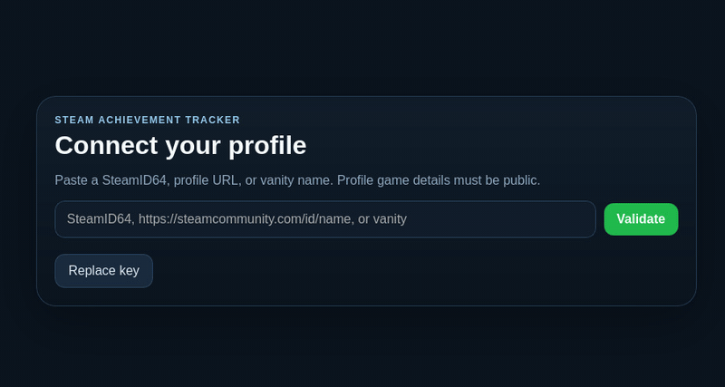
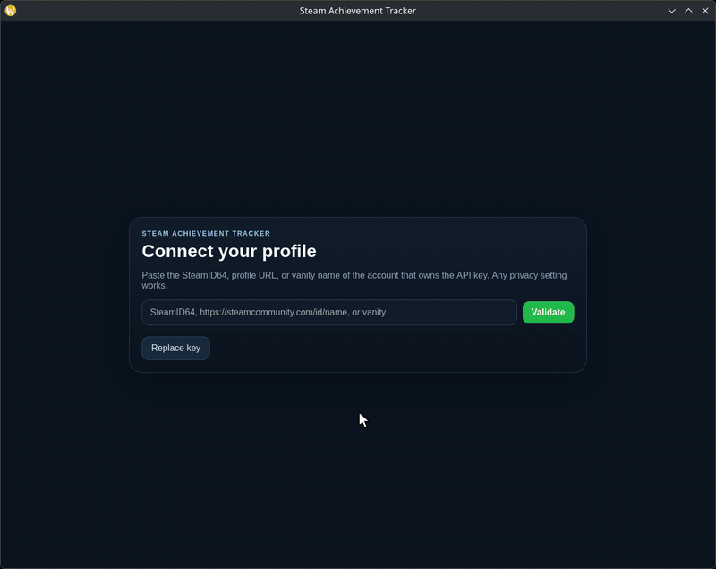
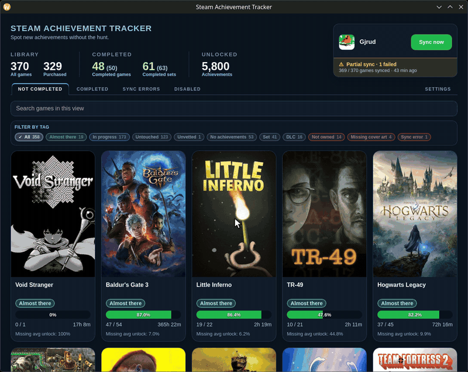
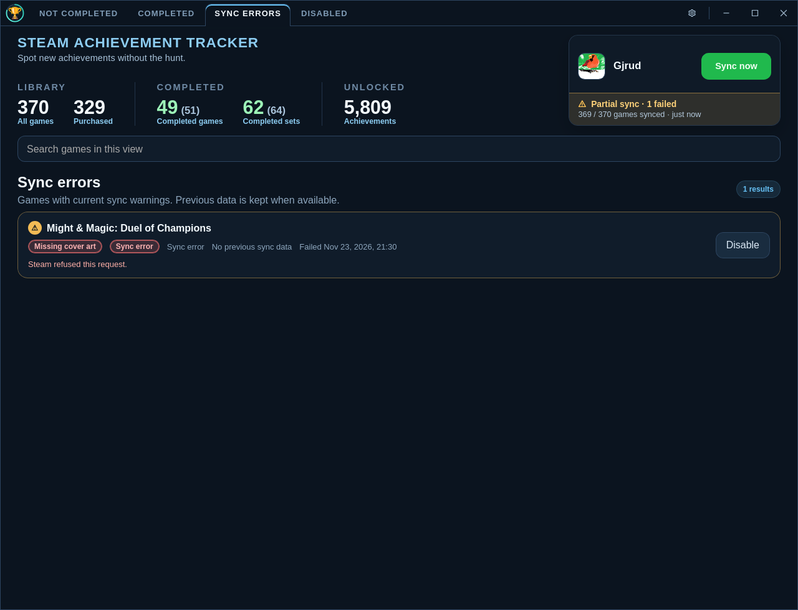
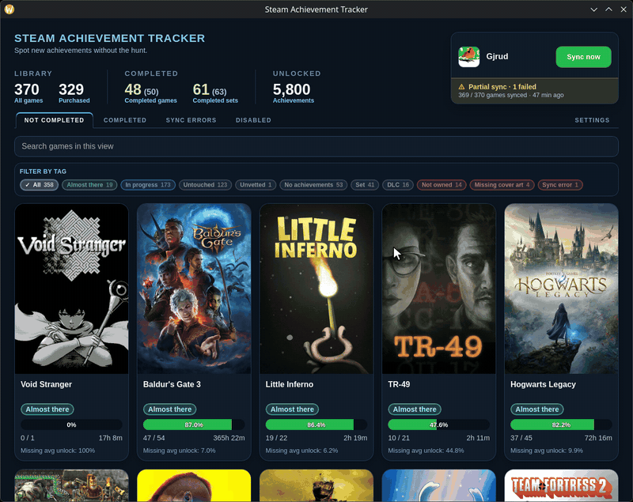

# Steam Achievement Tracker

[](LICENSE)
[](https://goreportcard.com/report/github.com/gjrud/steam-achievement-tracker)
[](go.mod)

Steam Achievement Tracker is a Linux and Windows desktop app for tracking your Steam achievement progress. It reads a
public Steam profile, keeps the results on your computer, highlights the games worth finishing next, and keeps sync
problems visible instead of silently losing old data.

This app was born for personal use and was entirely vibecoded. I have entry-level knowledge of Go, which I often use for
personal or work related CLI tools, but the Svelte/JavaScript frontend is far outside my own area of expertise.

## Features

- **Profile setup** from a SteamID64, a profile URL, or a vanity name. The profile is checked before it is saved.
- **Secure key storage**: your Steam Web API key is kept only in the system keyring.
- **Automatic and manual sync** of your library, playtime, purchase status, achievements and cover images from Steam.
- **Dashboard** with counters for games, purchased games, completed games and sets, and unlocked achievements, plus a
  profile card with the latest sync status.
- **Not completed** view: games ranked by how close they are to being finished, with search and tag filters.
- **Completed** view: achievement sets that are fully unlocked.
- **Sync errors** view: games whose latest refresh failed. Earlier data is kept.
- **Disabled** view: games you disabled, and games the profile no longer owns.
- **Achievement sets**: each set of a game (base game, named sets, DLC sets) is its own card, completed and disabled on
  its own.
- **Per-set actions**: mark as previously completed, flag missing achievements as DLC-related, disable or re-enable.
- **Library sync options** for unvetted apps and played free-to-play games, per profile.
- **Remove profile** from Settings. By default it only disconnects the profile and keeps its data. You can also delete
  the data and the saved API key.
- **Local storage** in SQLite, with a backup before database upgrades, and rotating log files.

## Requirements

### Linux requirements

- A Linux desktop session with the GTK 4 and WebKitGTK 6.0 runtime libraries. The deb, rpm and Arch packages install
  them as dependencies. If the AppImage fails to start, install the GTK 4 and WebKitGTK 6.0 runtime packages. On Debian
  and Ubuntu the packages are `libgtk-4-1` and `libwebkitgtk-6.0-4`.
- A Secret Service provider such as GNOME Keyring, unlocked while you use the app. The packages do not install one.

### Windows requirements

- Windows 10 or Windows 11, 64-bit (amd64). Windows Credential Manager is built in.
- Microsoft Edge WebView2 Runtime. Windows 11 includes it, and the setup installer adds it on Windows 10 when it is
  missing. The portable exe installs nothing. On Windows 10 the app may not start until the
  [WebView2 Runtime](https://developer.microsoft.com/microsoft-edge/webview2/) is installed, so install it first.

### Both systems

- A Steam Web API key (see [Get a Steam Web API key](#get-a-steam-web-api-key)).
- Network access to Steam's Web API and Steam's image servers.
- A Steam profile whose game details are public. Sync reads the owned-games list, so a private profile cannot be synced.

## Install

### Linux install

Download a package for your distribution (deb, rpm, or the Arch `pkg.tar.zst`) or the AppImage from the
[GitHub Releases](https://github.com/gjrud/steam-achievement-tracker/releases) page. Each release lists `SHA256SUMS` for
its files.

The packages install the program, a menu entry and the app icons, and the window and taskbar take their icon from that
menu entry. The AppImage cannot install the menu entry itself, so on KDE its window title bar may show a generic icon.

Removing the package removes the program files only. Your data, cache, logs and saved API key stay (see
[Data and privacy](#data-and-privacy)).

### Windows install

Each release has two amd64 files:

- `steam-achievement-tracker-<version>-windows-amd64-setup.exe`: a per-user installer. It needs no administrator rights,
  installs to `%LocalAppData%\Programs\Steam Achievement Tracker`, and adds a Start Menu shortcut (no desktop icon).
  Uninstalling removes the program files and the shortcut. It keeps your data, cache and saved API key.
- `steam-achievement-tracker-<version>-windows-amd64-portable.exe`: runs without installing. It uses the same data
  folder as the installer, so you can switch between the two.

The Windows builds are not code-signed. SmartScreen keeps warning about unsigned apps until downloads build reputation,
and may show "Windows protected your PC". Choose **More info**, then **Run anyway**. To check the file first, compare
its hash with `SHA256SUMS` on the release page. In PowerShell:

```powershell
Get-FileHash .\steam-achievement-tracker-<version>-windows-amd64-setup.exe -Algorithm SHA256
```

On Linux, run `sha256sum --check --ignore-missing SHA256SUMS` in the folder that holds the downloaded files. The
file lists every release asset, so `--ignore-missing` skips the ones you did not download.

### Get a Steam Web API key

1. Open <https://steamcommunity.com/dev/apikey> while signed in to Steam. The setup screen has a **Get a Steam Web API
   key** link that opens the same page.
2. When Steam asks for a domain name, enter `localhost`.
3. Start the app, paste the key on the setup screen and click **Save key**. Saving does not start a sync.

The app stores the key in the system keyring, under service `steam-achievement-tracker` and user `steam-web-api-key`:

- **Linux:** the Secret Service keyring. It may ask you to unlock it first.
- **Windows:** Windows Credential Manager, as a generic credential named `steam-achievement-tracker:steam-web-api-key`.
  View or delete it under **Credential Manager** > **Windows Credentials** > **Generic Credentials**.

### Launch

On Linux, start `steam-achievement-tracker` from your menu or a terminal. On Windows, start it from the Start Menu or
run the portable exe. If no key is stored, the app opens on the key setup screen. **Retry key lookup** reads the keyring
again, which helps if you stored the key some other way.

## Usage

### Change the API key

To enter the first key, see [Get a Steam Web API key](#get-a-steam-web-api-key). Settings cannot change the key. If no
profile is active, the profile setup screen has a **Replace key** button. Once a profile is connected, remove it with
**Delete API key** (see [Remove the active profile](#remove-the-active-profile)), enter the new key, then connect the
profile again. Its data is kept unless you also chose **Delete profile data**.



### Connect a Steam profile

On first launch, with a key saved and no active profile, enter one of:

- A SteamID64, such as `7656119...`
- A profile URL with its scheme, such as `https://steamcommunity.com/profiles/<steamid64>`
- A vanity URL with its scheme, such as `https://steamcommunity.com/id/<name>`
- A vanity name on its own

Click **Validate**. The app shows the Steam name and avatar it found. Click **Save and sync** to make it the active
profile and start a sync. Only one profile is active at a time.



### Sync

A sync starts when you save a profile, when the app starts with a profile and key present, and when you click
**Sync now**. While it runs, the button reads **Syncing…**, and the dashboard refreshes as the sync progresses.

- Games that Steam no longer lists for the profile are disabled for that profile. A game you disabled yourself stays
  disabled, even if Steam lists it again.
- Each achievement set of a game gets its own card. Achievements that Steam marks as archived are not counted.
- DLC sets stay in the list even when you do not own the DLC. They are tagged **Not owned**.
- If one game fails, the rest of the sync continues. The failed game keeps its previous data, appears in
  **Sync errors**, and the run is reported as partial.
- If the app closes during a sync, the sync stops and its run is recorded as failed. Games that were not finished keep
  their previous data. **Sync canceled** appears only for a run that never recorded its end, such as after a crash or
  power loss. The next start marks such a run canceled.

Steam limits how fast the app can ask for data. The app fetches up to four games at a time and retries requests that
Steam answers with a temporary error, so a large library takes a while.

### Dashboard

The header shows the profile card and five counters in three groups:

- **Library**: **All games** (games that are not disabled, including free-to-play games you have played) and
  **Purchased** (games that are not disabled and are in your account's purchased list). Played free-to-play games are
  not included in **Purchased**. Steam's purchased list may also include free license grants.
- **Completed**: **Completed games** (games whose base set is complete; a game with only a completed DLC set does not
  count) and **Completed sets** (completed base, named or DLC sets, each counted separately).
- **Unlocked**: **Achievements**, the unlocked achievements in games that are not disabled.

When some counted games or sets are unvetted (see [Library sync options](#library-sync-options)), a completed counter
shows the vetted count and the total, for example `12 (15)`, and the vetted number is green.

The profile card has your avatar, name and the **Sync now** button. Below them, the sync band shows the latest sync:

- **Green**, with a check mark: all games synced.
- **Amber**, with a warning: partial sync, with the number of failed games.
- **Red**, with a warning: sync failed, with the number of errors when there are any.
- **Blue**, with a spinner: a sync is running, shown as games synced out of games in the library.
- **Grey**: no sync yet, or the last sync was canceled.

Under the headline are the game counts and the time since the sync finished, such as "5 min ago" or "2 hours ago". After
seven days it shows the date and time instead. While a sync runs, the time reads `Started <time>` instead, using the
start time. Each state has an icon and text, so colour is not the only signal.

The main tabs are **Not completed**, **Completed**, **Sync errors**, **Disabled** and **Settings**. On a narrow window
the header stacks and the tabs wrap.

### Not completed

This view lists the games that are not complete yet. Each card shows cover art when cached, progress, playtime, tags
and, when Steam provides it, the average unlock rate of the achievements you are missing.



Search filters by title. The tag chips show only the cards with that tag, and each chip shows how many cards match.

### Completed

The **Completed** tab lists the games and sets where all known achievements are unlocked. Search and the tag chips work
the same way as on **Not completed**.


### Sync errors

This tab lists games whose latest refresh failed. Previous data is shown when the app has it. Use **Disable** to hide a
game that keeps failing. Right-click a row to mark the game previously completed, flag its missing achievements as
DLC-related, or disable it.



### Disabled

This tab lists the games you disabled and the games the profile no longer owns. Click **Re-enable** to bring a game
back.

### Achievement sets

Steam groups achievements into sets. A game with DLC or several sets (such as the class sets of Team Fortress 2) shows
one card per set:

- A set is completed on its own. A completed set moves to **Completed**, and its unfinished siblings stay in
  **Not completed**.
- Unnamed sets are named after the game, for example `Team Fortress 2 – Scout`. A card for a set other than the base set
  has the **Set** tag, and a card for a DLC set has the **DLC** tag.
- A DLC set you do not own is tagged **Not owned**. It has no progress, and its achievements are left out of the
  dashboard counters. The next sync after you buy the DLC removes the tag.
- Sets show the same playtime as their game, because Steam reports playtime per game.
- Sets without achievements are not shown.

Search matches the game name, so it lists all set cards for that game. Disable and re-enable work on one card at a time.
If every set of a game is disabled, the game is skipped during sync, so new DLC sets appear only after you re-enable one
of its sets.

### Cover art

The app downloads cover images from Steam's image servers into its cache folder. A base game uses the library image from
your owned-games data. DLC sets, and games without that image, use other images that Steam lists for the app. A DLC set
without its own image shows its parent game's cover. A cover that Steam does not have is checked again after 7 days.
Until a cover is downloaded, the card shows the first letter of the title and **Missing cover art**.

### Tags and sorting

The **Not completed** list puts the games closest to being finished first:

1. Games with achievements that are not flagged as DLC-related. Games flagged **New achievements added** come first.
2. DLC sets you do not own (**Not owned**), sorted by title. These never rank above a real candidate.
3. Games flagged **Achievements in DLC**, sorted by suggestion score.
4. Games with no Steam achievements, sorted by title.

Within the first group, games sort by suggestion score, highest first. The score comes from your completion percentage
and, when Steam provides it, the average unlock rate of the achievements you are missing.

| Tag | Meaning |
| --- | --- |
| **New achievements added** | The game was complete before, but Steam has added locked achievements since. Incomplete cards only. |
| **Almost there** | The game has playtime and its suggestion score is 40 or higher. |
| **In progress** | The game has playtime, and its suggestion score is below 40. |
| **Untouched** | The game has no recorded playtime. |
| **Unvetted** | Steam has not vetted the app yet. Appears on games synced while **Include unvetted apps** was on: every card of such a game, including set and DLC cards and completed cards, has it and can be filtered by it. The next sync after Steam vets the app clears it. A game that leaves the library keeps its last known vetted state, so it may still show the tag in **Disabled**. |
| **No achievements** | Steam reports no achievements for the game. |
| **Set** | The card is an achievement set other than the game's base set. |
| **DLC** | The set belongs to a DLC. |
| **Not owned** | The set belongs to a DLC you do not own. It has no progress tags. |
| **Achievements in DLC** | You flagged the remaining achievements as DLC-related. Incomplete cards only. |
| **Missing cover art** | No cover is cached. A DLC set counts as covered when its parent game is. |
| **Sync error** | The latest refresh of this game failed. |
| **Completed** | Shown on completed cards. |

The filter chips and the card tags follow the order of this table. On completed cards, **Completed** comes first, but it
has no filter chip. A view shows only the chips for tags that at least one of its cards has. Changing tabs clears the
selected chip, but search still applies.

### Right-click actions

Right-click a game card or a row in **Sync errors** to open the game menu:

- **Disable game** or **Disable set** hides it from the active views and totals, and skips it during sync. Re-enable it
  from **Disabled**.
- **Mark as previously completed** is for a game that was complete before Steam added more achievements. It adds the
  **New achievements added** tag while the game is incomplete.
- **Flag missing achievements in DLC** is for remaining achievements that belong to DLC or to content you do not plan to
  count. It adds the **Achievements in DLC** tag.

These flags are local bookkeeping, kept per profile on your computer. Both can be cleared from the same menu.


### Library sync options

Open **Settings** to choose what a sync of the active profile loads. Each profile has its own settings, and a new
profile starts with both on:

- **Include unvetted apps**: includes new Steam apps that Steam hides until it vets them. Those games are tagged
  **Unvetted** and counted separately in the **Completed** counters. With the option off, every game counts as vetted.
- **Include played free games**: includes free-to-play games you played without buying. With the option off, only
  purchased games are tracked, and **Purchased** equals **All games**.

A change applies on the next sync and does not start one. Turning an option off removes the games it excluded on that
sync, so they may show as no longer owned and appear in **Disabled**.

### Remove the active profile

Open **Settings** and use **Remove profile** in the **Remove active profile** section. The dialog asks you to type the
value it shows (the profile's SteamID64) before the button is enabled. Two switches, both off by default, choose what
else is deleted:

- **Delete profile data** deletes the profile's games, playtime and purchase status, achievements, sync history, manual
  flags, tags, library sync settings and cached covers.
- **Delete API key** deletes the Steam Web API key from the system keyring. The app then shows the key screen, and sync
  stays unavailable until you enter a key again.

The confirm button says what will be deleted, such as **Remove profile and data**. Logs are never deleted.

With both switches off, the profile is only disconnected. Its data stays on disk and the key is kept. Connecting the
same SteamID64 again restores the data and starts a sync. Data from a disconnected profile stays on disk until you
reconnect that profile and remove it with **Delete profile data**. If you deleted the profile's data, connecting it
again starts with both library sync options on.



## Data and privacy

The app keeps its files in three folders for your user account. Each one ends in `steam-achievement-tracker`. The
environment variables `XDG_DATA_HOME`, `XDG_CACHE_HOME` and `XDG_STATE_HOME` change the base folders on both systems.

| Folder | Linux | Windows | Holds |
| --- | --- | --- | --- |
| Data | `~/.local/share/steam-achievement-tracker/` | `%LocalAppData%\steam-achievement-tracker\` | The database and its backups |
| Cache | `~/.cache/steam-achievement-tracker/` | `%LocalAppData%\cache\steam-achievement-tracker\` | Cover images. On Windows also the WebView2 browser profile (`webview/`) |
| State | `~/.local/state/steam-achievement-tracker/` | `%LocalAppData%\steam-achievement-tracker\` | Log files (`logs/`) |

On Windows, the data and state folders are the same. The **Settings** screen shows the data, cache and log folders and
the current log file.

The folders are created for your user only. Windows does not use the Linux permission bits, so there it relies on the
permissions of your user profile.

The cache can be deleted at any time. The next sync downloads the covers again, and until then the cards show
placeholders.

Your Steam Web API key is stored only in the system keyring, not in these folders (see
[Get a Steam Web API key](#get-a-steam-web-api-key)). The app deletes that keyring item only when you choose
**Delete API key**.

Privacy: the app talks only to Steam, through Steam's Web API and its image servers. It sends no data to any other
service. Your API key is sent only to the Steam requests that need it, and the app never writes the key to its logs or
to error messages.

## Troubleshooting

- **"Steam profile not found", a profile URL error or a vanity name error**: check the SteamID64, profile URL or vanity
  name. A URL must include its scheme, such as `https://`, and contain `/profiles/<steamid64>` or `/id/<name>`. Without
  the scheme, the text is treated as a vanity name and fails.
- **Sync fails or the profile shows no games**: the profile's game details must be public. Check the profile's privacy
  settings on Steam.
- **"Steam Web API key missing"**: enter the key on the setup screen. If you stored it outside the app, click
  **Retry key lookup**.
- **The key does not save on Linux**: unlock your Secret Service keyring and try again. If you dismissed the unlock
  prompt, the app reports that the key was not stored instead of reporting success.
- **Startup error screen**: the message names the problem and shows the log file. The log has the details.
- **Portable exe does not start on Windows 10**: install the WebView2 Runtime first (see
  [Windows requirements](#windows-requirements)).
- **SmartScreen warning on Windows**: see the note in [Windows install](#windows-install).
- **Covers are blank**: they download on the next sync. If Steam has no image for a game, the card keeps the
  placeholder.
- **Sync failed or partial**: open the **Sync errors** tab to see which games failed. The next sync retries them.
- **A game is missing**: check whether it is disabled, whether **Include played free games** or
  **Include unvetted apps** is off, and whether Steam still lists it for the profile.

The log file is in the state folder listed in [Data and privacy](#data-and-privacy).

## For developers

The developer documentation is in [docs/](docs/README.md). It covers the architecture, the Go packages, the database,
the sync logic, the frontend, the tests, and the build and release process.

Quick start from the repository root:

```sh
wails3 dev     # run the app in development mode
wails3 build   # build the production binary in bin/
```

Build prerequisites and packaging are in [docs/build-and-release.md](docs/build-and-release.md). Testing is covered in
[docs/testing.md](docs/testing.md).

Security issues: see [SECURITY.md](SECURITY.md). The license is MIT, see [LICENSE](LICENSE).
