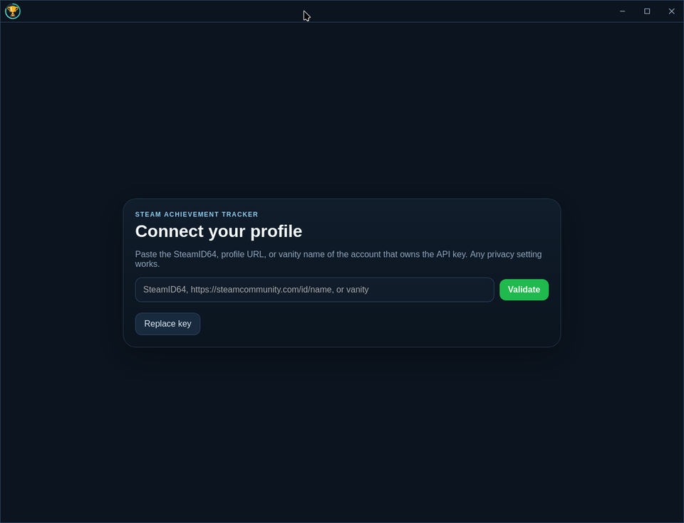
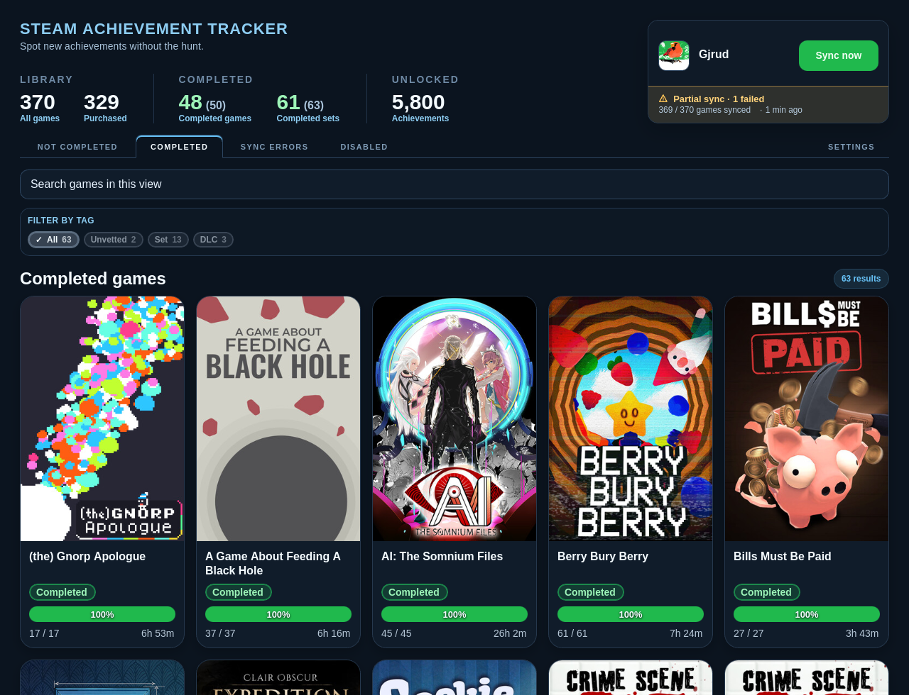
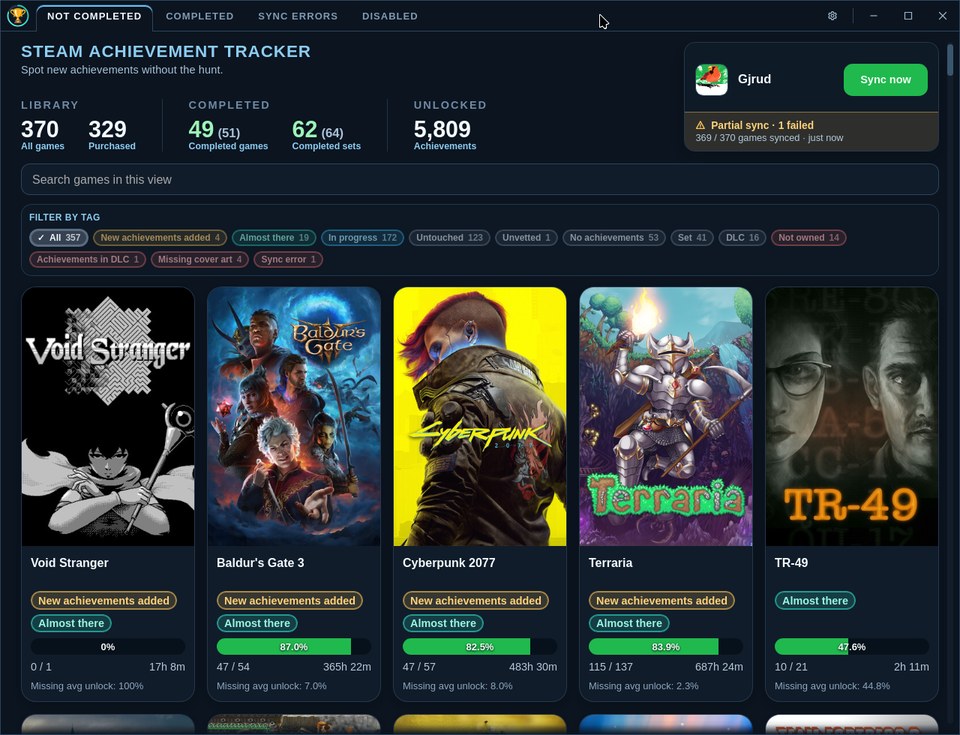

# Steam Achievement Tracker

[](LICENSE)
[](go.mod)
[](#requirements)
[](https://github.com/gjrud/steam-achievement-tracker/actions/workflows/ci.yml)
[](https://github.com/gjrud/steam-achievement-tracker/actions/workflows/github-code-scanning/codeql)
[](https://github.com/gjrud/steam-achievement-tracker/releases)


Steam Achievement Tracker is a Linux and Windows desktop app that tracks your Steam achievement progress. It reads your Steam profile and keeps the results on your computer. It highlights games worth finishing next and makes sync problems visible instead of silently losing old data.

I built this app for personal use, entirely through vibecoding. I have entry-level knowledge of Go, which I often use for personal or work-related CLI tools, but the Svelte/JavaScript frontend is far outside my area of expertise.

## Features

- Connect a profile from a SteamID64, a profile URL, or a vanity name. The profile is checked before it is saved.
- Sync your library, playtime, achievements, and cover images from Steam, automatically or on demand.
- A dashboard with counters and the latest sync status, and views for games that are not completed, completed, failed to sync, or disabled.
- Games ranked by how close they are to completion. Each achievement set (base game, named sets, DLC) is its own card.
- Per-game actions: disable or re-enable, mark as previously completed, flag missing achievements as DLC-related.
- Your Steam Web API key is stored only in the system keyring. Everything else stays on your computer, in a local SQLite database, a cover cache, and log files.
- Update checks against this project's GitHub releases, which you can turn off. Some installs can update in place.

## Requirements

- **Linux:** a desktop session with the GTK 4 and WebKitGTK 6.0 runtime libraries, and a Secret Service provider such as GNOME Keyring, unlocked while you use the app. The deb, rpm, and Arch packages install the libraries. If the AppImage fails to start, install them (on Debian and Ubuntu: `libgtk-4-1` and `libwebkitgtk-6.0-4`). No package installs a Secret Service provider.
- **Windows:** Windows 10 or 11, 64-bit. Windows 10 may need the [WebView2 Runtime](https://developer.microsoft.com/microsoft-edge/webview2/); the installer adds it when missing, the portable exe does not.
- **Both:** a Steam Web API key from the account that owns the profile, and network access to Steam and, for update checks, GitHub. The profile can have any privacy setting, including private.

## Install

Download a file from the [GitHub Releases](https://github.com/gjrud/steam-achievement-tracker/releases) page. Each release lists `SHA256SUMS` for its files. Check a download with `sha256sum --check --ignore-missing SHA256SUMS` on Linux, or `Get-FileHash <file> -Algorithm SHA256` in PowerShell.

- **Linux:** a deb, rpm, or Arch (`pkg.tar.zst`) package, or the AppImage. Removing a package removes only the program files.
- **Windows:** `steam-achievement-tracker-<version>-windows-amd64-setup.exe` (per-user installer, no administrator rights, Start Menu shortcut) or `...-windows-amd64-portable.exe` (runs without installing; same data folder as the installer). The builds are not code-signed, so SmartScreen may show "Windows protected your PC". Choose **More info**, then **Run anyway**.

Uninstalling never removes your data, cache, logs, or saved API key.

### Get a Steam Web API key

1. While signed in to Steam, open <https://steamcommunity.com/dev/apikey>.
2. When Steam asks for a domain name, enter `localhost`.
3. Start the app, paste the key on the setup screen, and click **Save key**. Saving does not start a sync. Then [connect your profile](#connect-a-profile).

The key is stored in the system keyring under service `steam-achievement-tracker` and user `steam-web-api-key` (Secret Service on Linux; a generic credential in Windows Credential Manager). Settings cannot change the key. To replace it before a profile is connected, use **Replace key** on the setup screen. Once a profile is connected, remove the profile with **Delete API key** turned on (see [Remove the profile](#remove-the-profile); leave **Delete profile data** off to keep its data), enter the new key, and connect the same profile again.



## Usage

### Connect a profile

With a key saved and no profile active, enter a SteamID64, a profile URL with its scheme (`https://steamcommunity.com/profiles/<steamid64>` or `https://steamcommunity.com/id/<name>`), or a vanity name. Click **Validate** to see the Steam name and avatar the app found, then **Save and sync** to make the profile active and start a sync. Only one profile is active at a time.


### Sync and dashboard

A sync starts when you save a profile, when the app starts with a profile and key, and when you click **Sync now**.

- If one game fails, the rest of the sync continues. The failed game keeps its previous data and appears in **Sync errors**.
- Games Steam no longer lists for the profile are disabled. A game you disabled yourself stays disabled.
- Steam rate-limits requests, so a large library takes a while. If the app closes during a sync, the run is recorded as failed and unfinished games keep their previous data.

The dashboard shows the profile card, with the latest sync status and **Sync now**, and counters for games, purchased games, completed games and sets, and unlocked achievements. If some counted games are unvetted (see [Library sync options](#library-sync-options)), a completed counter shows the vetted count followed by the total, such as `12 (15)`. The title bar holds the views below, and a gear icon opens **Settings**.

### Achievement sets

A game with DLC or several sets (such as Team Fortress 2's class sets) gets one card per set. Each set is completed and disabled on its own, and a set shares its game's playtime. A DLC set you do not own is tagged **Not owned**, and its achievements are left out of the counters. Sets without achievements are not shown.

### Not completed

Games ranked by how close they are to being finished, with title search and tag filters. Cards show progress, playtime, tags and cover art. The order uses a suggestion score from your completion percentage and, when Steam provides it, the average unlock rate of the achievements you are missing. Among the normal candidates, games flagged **New achievements added** come first; then come unowned DLC sets, then games flagged **Achievements in DLC**, then games with no achievements.


| Tag | Meaning |
| --- | --- |
| **New achievements added** | The game was complete before, but Steam has added locked achievements since. |
| **Almost there** | The game has playtime and a suggestion score of 40 or higher. |
| **In progress** | The game has playtime and a score below 40. |
| **Untouched** | The game has no recorded playtime. |
| **Unvetted** | Steam has not vetted the app yet. Cleared by the next sync after Steam vets it. |
| **No achievements** | Steam reports no achievements for the game. |
| **Set** / **DLC** / **Not owned** | The card is a non-base set, a DLC set, or a DLC set you do not own. |
| **Achievements in DLC** | You flagged the remaining achievements as DLC-related. |
| **Missing cover art** | No cover is cached. |
| **Sync error** | The latest refresh of this game failed. |

### Completed

Fully unlocked games and achievement sets, with the same search and tag filters.



### Sync errors

Games whose latest refresh failed. Earlier data is kept, and the next sync retries them. Use **Disable** to hide a game that keeps failing.


### Disabled

Games you disabled and games the profile no longer owns. Right-click a card, or a row in **Sync errors**, and choose **Disable game** (or **Disable set**) to hide it from the views and totals and skip it during sync. Click **Re-enable** in **Disabled** to bring it back.



### Flags

The same right-click menu has two flags. **Mark as previously completed** is for a game that was complete before Steam added achievements; it adds the **New achievements added** tag while the game is incomplete. **Flag missing achievements in DLC** is for remaining achievements that belong to DLC or to content you do not plan to count; it adds the **Achievements in DLC** tag. Flags are local bookkeeping stored per profile and can be cleared from the same menu.


### Library sync options

In **Settings**, each profile has two options, both on for a new profile:

- **Include unvetted apps**: includes new Steam apps that Steam hides until it vets them. They are tagged **Unvetted** and counted separately in the **Completed** counters.
- **Include played free games**: includes free-to-play games you played without buying. With it off, only purchased games are tracked.

Changes apply on the next sync. Turning an option off moves the games it excludes to **Disabled**; turning it back on brings them back.

### Remove the profile

**Remove profile** in **Settings** asks you to type the profile's SteamID64. Two switches, both off by default, choose what else is deleted:

- **Delete profile data**: the profile's games, achievements, sync history, flags, tags, library sync settings and cached covers.
- **Delete API key**: the key in the system keyring. The app then shows the key screen again.

With both off, the profile is only disconnected: its data stays on disk, and connecting the same SteamID64 again restores it. To delete disconnected data, reconnect the profile (this starts a sync) and remove it with **Delete profile data**, or delete all app data by removing the folders (see [Data and privacy](#data-and-privacy)). Neither switch deletes log files.


## Updates

The app checks GitHub for a newer stable release a few seconds after startup, and when you click **Check now** in **Settings**. A banner offers **Install**, the release notes, and **Later**. Nothing is downloaded until you click **Install**.

- **Updates in place:** the Windows portable exe, the Windows per-user installer, and the Linux AppImage. **Restart now** applies a downloaded update and cancels a running sync; a new sync starts when the app reopens. If the new version cannot start, the previous version is restored; if it starts and then crashes, there is no rollback.
- **Notice only:** Linux deb, rpm and Arch packages show the banner without **Install**. Update them with your package manager.
- **Integrity:** each download is compared with `SHA256SUMS` from the same release. This detects damage, not a forged release. To check where a file came from, run `gh attestation verify <file> --repo gjrud/steam-achievement-tracker`.
- **Turn checks off:** clear **Check for updates on startup** in **Settings**. **Check now** still works.
- Pre-releases are never offered. Builds made from source without a version tag have no update checks. An older build refuses a database that a newer build has upgraded, so never reinstall an older version over a newer one.
- GitHub limits unauthenticated requests to 60 per hour per IP address. If a check fails, try again later.

## Data and privacy

All your data stays on your computer. The app has no accounts, telemetry, or analytics, and never sends your library, profile, or key to the developer or any other service. It connects only to:

- **Steam's Web API** (`api.steampowered.com`): your key is sent only to the requests that need it.
- **Steam's CDN**, for cover art and avatars.
- **GitHub** (`api.github.com` and its file host), for update checks and downloads. No account or identifier is sent, but GitHub sees your IP address.

Files live in three folders ending in `steam-achievement-tracker` (the `XDG_DATA_HOME`, `XDG_CACHE_HOME` and `XDG_STATE_HOME` variables change the base folders). **Settings** shows the exact paths.

| Folder | Linux | Windows | Holds |
| --- | --- | --- | --- |
| Data | `~/.local/share/steam-achievement-tracker/` | `%LocalAppData%\steam-achievement-tracker\` | The SQLite database and its pre-upgrade backups (`backups/`) |
| Cache | `~/.cache/steam-achievement-tracker/` | `%LocalAppData%\cache\steam-achievement-tracker\` | Cover images (and the WebView2 profile on Windows). Safe to delete. |
| State | `~/.local/state/steam-achievement-tracker/` | `%LocalAppData%\steam-achievement-tracker\` | Log files (`logs/`), rotated at 5 MB |

The API key is never written to the database, the logs, or error messages. Logs can still contain your Steam app IDs and Steam's raw error text. Before sharing a database, log file, or screenshot (for example, in a bug report), remove or blur your display name, SteamID64, and avatar. Database backups made by older upgrades may still hold file paths with your user name, or old error text with your SteamID64; delete any you do not need from `backups/`.

To erase everything, close the app and delete the three folders, the `steam-achievement-tracker` item in your keyring (unless you used **Delete API key**), and any `wails-update-<pid>.log` files in your system's temporary folder (they contain full file paths, including your user name).

## Troubleshooting

- **Profile or vanity name not found**: check the SteamID64, link or name. A link needs its scheme (`https://steamcommunity.com/profiles/<number>` or `.../id/<name>`); without it, the text is treated as a vanity name.
- **Sync fails or shows no games**: the profile must belong to the account that owns the API key. Any privacy setting works.
- **"Steam Web API key missing"**: enter the key on the setup screen, or click **Retry key lookup** if you stored it outside the app.
- **The key does not save on Linux**: unlock your Secret Service keyring and try again.
- **Startup error screen**: the message names the problem. The log file, shown on the screen, has the details.
- **App does not start on Windows 10**: install the WebView2 Runtime first.
- **Covers are blank**: they download on the next sync. If Steam has no image, the card keeps the placeholder until a later sync finds one.
- **A game is missing**: check whether it is disabled, whether **Include played free games** or **Include unvetted apps** is off, and whether Steam still lists it for the profile.
- **"The app folder is not writable"** (update): download the new release and install it by hand.

## Development

The Go backend is at the repository root and in `internal/`. It is a [Wails v3](https://v3.wails.io) app that stores data in SQLite (`go-sqlite3`, CGO) and the key in the system keyring. The frontend is Svelte 5 + Vite in `frontend/`, embedded into the binary. `build/` holds the packaging files, `.github/` the CI and release workflows, and `docs/` the developer documentation.

Building needs Go, Node.js with npm, the Wails v3 CLI (`wails3`) at the version in `go.mod`, and on Linux a C compiler, `pkg-config`, and the GTK 4 and WebKitGTK 6.0 development headers. Windows builds run only on Windows, with MinGW-w64 and NSIS. See [docs/build-and-release.md](docs/build-and-release.md#prerequisites) for exact versions.

From the repository root:

```sh
wails3 dev                          # run the app in development mode
wails3 build                        # build the production binary in bin/
VERSION=0.0.0-dev wails3 package    # Linux packages in bin/
(cd frontend && npm ci && npm test) # frontend tests
go test ./internal/...              # backend tests
```

`wails3 package` builds for the current OS only. Packages, and production builds on Windows, need a version: set `VERSION` or check out a `vX.Y.Z` tag. Releases are built by the release workflow when a `vX.Y.Z` tag is pushed. See [docs/testing.md](docs/testing.md) for the full verification sequence, and [docs/](docs/README.md) for the architecture, packages, database, sync logic and release procedure.

For security issues, see [SECURITY.md](SECURITY.md). The license is MIT; see [LICENSE](LICENSE).
