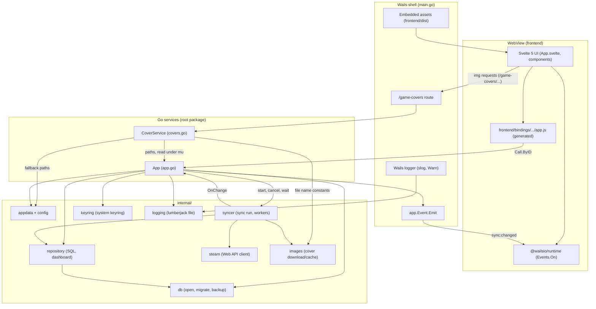

# Architecture

This document explains the Steam Achievement Tracker's architecture: its layers, startup and shutdown sequence, frontend-to-backend communication, and handling of errors, secrets, and concurrency. It describes the code as of writing. The user guide, [../README.md](../README.md), covers user-facing behavior; the code remains the source of truth.

The app is a Wails v3 desktop application for Linux and Windows 10+ (amd64). The Go backend lives at the repository root (`main.go`, `app.go`, `covers.go`, `wailslog.go`) and in `internal/`. The Svelte 5 frontend lives in `frontend/` and is embedded into the binary from `frontend/dist`.

## Stack

| Concern | Technology |
| --- | --- |
| Desktop shell | [Wails v3](https://v3.wails.io) (`v3.1.0`). Linux: GTK 4 + WebKitGTK 6.0 through CGO. Windows 10+ amd64: WebView2. |
| Backend | Go 1.26 (`go.mod`: 1.26.2). Exported `App` methods are bound to the frontend as a Wails service. |
| Local storage | SQLite through `github.com/mattn/go-sqlite3` (CGO; SQLite is compiled in, no system library needed), WAL mode. |
| Secrets | `github.com/zalando/go-keyring`: Secret Service (D-Bus) on Linux, Windows Credential Manager on Windows. |
| Logging | Standard `log` with `gopkg.in/natefinch/lumberjack.v2` rotation. The Wails `slog` logger is bridged into it (`wailslog.go`). |
| Frontend | Svelte 5 + Vite 8, talking to Go through generated Wails bindings and `@wailsio/runtime` `3.1.0`. The code imports the generated bindings from `frontend/bindings/`; no Wails v2 `wailsjs` runtime is used. |
| Frontend tests | Vitest 5, Testing Library, jsdom. |
| Build and packaging | Wails v3 CLI over [Task](https://taskfile.dev) (`Taskfile.yml`, `build/`). nfpm for deb, rpm and Arch packages, AppImage through `wails3 generate appimage`, Windows portable exe and NSIS user-scope installer (`build/windows/`). |

Build steps and the release workflow are in [build-and-release.md](build-and-release.md).

## Layers

| Layer | Where | Role |
| --- | --- | --- |
| Wails shell | `main.go`, `wailslog.go` | Creates the `application.New` app, registers services, embeds assets, opens the window, bridges the Wails logger to `app.log`, emits the sync event. |
| App service | `app.go` (`App`) | Bound to the frontend. Owns the lifetime context, the cached API key state, the sync goroutine, and the init sequence. Orchestrates every user action. |
| Cover service | `covers.go` (`CoverService`) | Plain `http.Handler` mounted at `/game-covers`. Serves cached cover images from disk. Not bound to the frontend. |
| Domain and infrastructure | `internal/*` | Paths, database, repository (SQL), Steam client, syncer, image cache, keyring, logging. No Wails imports. |
| Frontend | `frontend/src/` | Svelte 5 UI. Calls bound methods through generated bindings, and refetches state on the `sync:changed` event. |

Wails v3 services such as `App` and `CoverService` are plain Go structs. `App` uses its own lifetime context rather than a Wails runtime context: it creates it in `NewApp` and cancels it in `ServiceShutdown`.

## Component diagram

Arrows indicate call direction. `Syncer` reports state changes to `App` through the `OnChange` callback, which `App` wires to `emitSyncChanged`.

## Startup

`main.go` runs these steps in order:

1. `NewApp()` creates the `App` with its lifetime context.
2. On Windows only, the WebView2 profile folder (`<cache>/webview`) is created before the window. If that fails, the profile path is left empty so Wails uses its default. Linux does not use a WebView2 profile.
3. `application.New` is called with the Wails logger (`newWailsLogger(logWriter{})`), the icon, the platform options (WebView2 profile path, GTK application id), and two services: `App` (no route) and `CoverService` (route `/game-covers`, name `covers`).
4. `backend.setEventEmitter` hands the app's event bus to `App`. The emitter is set before `Run`, so events from the first sync are delivered.
5. The main window is created (1280x980, minimum 900x650) with `app.Window.NewWithOptions`.
6. `app.Run()` starts the services. Wails v3.1.0 starts services inside `Run` before pending windows are run, and it attaches each service's `Route` to the asset server at that point.

`ServiceStartup` on `App` then runs the initialization sequence (`ensureInitialized`, in `app.go`):

1. `appdata.Resolve()` computes the data, cache, state and log paths from the XDG (or Windows Known Folder) base directories.
2. `appdata.Ensure()` creates the directories with mode `0700`. On failure, `logging.Fallback()` is called and the error is recorded as the init error.
3. `logging.Init()` opens `app.log` (lumberjack rotation, 5 MB, 5 backups). From here on, `log.Print` writes to the file.
4. `db.OpenAndMigrate()` opens the SQLite database (WAL mode, one connection), applies pending migrations, and takes a backup first when the database already has tables and a migration is due. See [database.md](database.md).
5. `repository.New(db)` wraps the connection. `CancelRunningSyncRuns("app restarted before sync completed")` marks any run still `running` as `canceled`. A failure there is logged only.
6. The Steam Web API key is read once from the keyring into the cache. `keyring.ErrMissing` means no key. Any other error is logged and kept as `apiKeyError`.
7. The state is published under `mu`: `initialized = true`, paths, repo, key cache, `initError` cleared.

If any step fails, `initialized` stays false, `initError` holds the message, and the next call to `ensureInitialized` retries the whole sequence. `ServiceStartup` always returns `nil`, so a failed init does not stop the app from starting. The frontend shows the failure from `AppState.InitError`.

After init, `ServiceStartup` reads the state. If an API key is present and a profile exists, it calls `startSync(false)`, which starts a background sync without forcing one if a sync is already running.

## Shutdown

On the normal quit path, Wails v3.1.0 runs `application.App.cleanup`. It cancels the Wails app context, runs `shutdownServices` through `InvokeSync`, and then closes the windows. `shutdownServices` calls each service's `ServiceShutdown` in reverse registration order, so `CoverService` (registered second) goes first; it has no shutdown hook. Then `App.ServiceShutdown`:

1. Cancels the lifetime context. Any later `startSync` returns `errShuttingDown`, and any `context()`-derived request fails.
2. Reads the current `syncCancel` under `mu` and cancels the running sync.
3. Waits on `syncWG`, which the sync goroutine releases in `endSync` after its final event.
4. Clears `repo` under `mu` and closes the database.

Wails closes the windows only after `shutdownServices` returns, so the frontend may still be running. A call that reaches Go after step 4 behaves as follows:

- `GetAppState` does not fail. `initialized` stays true and `repo` is nil, so it returns a state with `profileExists` false, a null dashboard and no error. The frontend routes on that state (see [frontend.md](frontend.md)).
- Actions that need the repository (`SaveProfile`, `SetLibrarySettings`, `ClearActiveUserData`, and the game actions) fail with `database is not initialized`.
- `SyncNow` and `ValidateProfile` call `requireAPIKey` first. Without a key they return `keyring.ErrMissing` (or the keyring read error). With a key, `SyncNow` returns `shutting down`, and `ValidateProfile` fails on its cancelled request context.
- `SaveAPIKey` and `RetryAPIKey` still reach the keyring.

The final `sync:changed` event does not block shutdown. `endSync` emits it through `app.Event.Emit`, which only queues it on an unbounded mailbox (`frontendEvents` in Wails `pkg/application/events.go`), so `syncWG.Done` still runs. Delivery to the webview needs the UI thread: the window queues the script and schedules `InvokeAsync(drainEventQueue)`. That drain cannot start until the `InvokeSync` callback in `cleanup` returns, and the window is marked destroyed only after several asynchronous steps (`windowEvents`, then `InvokeSync(markAsDestroyed)`). Whether the event reaches the webview is therefore a race, and once the event loop has quit the drain may never run.

The `defer` of `shutdownServices` in `Run` is only a fallback for startup failures; it finds no services left once the normal path has run. The sync run that was interrupted ends as `failed` with no per-game warnings, and games interrupted mid-sync keep their previous data.

## Sync events (`sync:changed`)

The sync notifies the frontend when its state changes; the frontend does not poll for sync state.

The event name is the constant `syncChangedEvent = "sync:changed"` in `app.go`. It has no payload. The frontend declares the same constant in `App.svelte`, and a test keeps the two in step.

Emit points:

| Point | Where | Emitted by |
| --- | --- | --- |
| Sync accepted | before the goroutine starts | `startSync` through `emitSyncChanged` |
| Run row created | after `StartSyncRun` | `FullSync` through `Service.changed` |
| Per-game progress | after each game success or failure, after its progress write | `updateProgress` through `changed` |
| Final run status | after `FinishSyncRun` | `finish` through `changed` |
| Flag cleared | after `syncInProgress` is set to false | `endSync` through `emitSyncChanged` |

`endSync` also runs on the early-exit paths of `startSync`: no repo, no key, a failed active-profile read, no profile, a failed library settings read (the only way building the Steam client fails), or a failed latest-run read. Emission goes through `emitSyncChanged`, which reads the emitter under `mu` and calls it after releasing `mu`.

Frontend side (`App.svelte`):

1. `onMount` subscribes with `Events.On('sync:changed', requestRefresh)` before the first read.
2. `requestRefresh` sets a queued flag. Reads never overlap, wait for user actions in flight, and a burst of events collapses into one extra `GetAppState` read.
3. If a read fails while the state still says a sync is running, the frontend retries every 2 seconds until a read succeeds. No other polling of backend state runs. Purely UI timers, such as the clock in `ProfileCard.svelte`, do not read state.

The final event is emitted after the flag is cleared, so the refetch that follows reads `syncInProgress = false`. `GetAppState` also re-checks the sync state against the stored run (`syncStillRunning`), so a run whose final status was written just before the flag cleared is not reported as running.

## Bound methods and bindings

Exported methods on `*App` make up the frontend API. The binding flow is:

1. Go source: an exported method on `*App` in `app.go`.
2. `wails3 generate bindings` (run by `wails3 dev` and `wails3 build`) writes `frontend/bindings/github.com/gjrud/steam-achievement-tracker/app.js` and `models.js`. The directory is git-ignored and must not be edited.
3. The frontend imports the functions from that path. Each function calls `$Call.ByID` with a numeric method id. A Go error becomes a rejected promise. A method returning `(T, error)` resolves to the value.
4. The generator excludes these names from the binding set: `ServiceName`, `ServiceStartup`, `ServiceShutdown`, and `ServeHTTP` (see `internal/generator/collect/service.go` in Wails v3.1.0). Unexported methods are never bound, so helpers such as `setEventEmitter` stay internal.

After changing exported `App` methods, regenerate the bindings and update `frontend/src/test/wails-app-mock.js`. The drift test that enforces this is described in [app-service.md](app-service.md#frontend-binding-contract) and [testing.md](testing.md).

The full list of bound methods, their parameters, results and errors is in [app-service.md](app-service.md).

## Error handling

- **Bound method errors** are returned to the frontend, which shows them in a banner, except for `SaveAPIKey` errors. The key form shows those (see `saveApiKey` and `savingKey` in `App.svelte`), and the banner is left alone. Wails also logs them at Error level through the Wails logger (`wailslog.go`), so their text reaches `app.log`. Error text must therefore never contain the API key, and bound methods return constant messages or wrapped backend errors.
- **Init errors** are not returned from `ServiceStartup`. They are kept in `AppState.InitError`, and the next call retries the init.
- **Background sync errors** are logged with the `log` package. A per-game failure is saved as a warning on that game's entries and counted in the run. A run ends as `success`, `partial` (some games failed), `failed` (run-level error or cancellation) or `canceled` (left `running` when the app restarted).
- **Stale runs**: if a sync ends but its final status cannot be saved, the row stays `running`. `GetAppState` then reports it as `failed` without changing the row. The next start marks it `canceled`.
- **Steam HTTP errors** keep the API key, the `steamid`, `steamids` and `vanityurl` query values and bare SteamID64s redacted in the URL of the error and in response bodies (`internal/steam`).
- **Logging failures** never stop the app. Writes to `app.log` go through the logging package's lock.

## Secret handling

The Steam Web API key is the only secret.

- It is stored only in the system keyring (Secret Service on Linux, Windows Credential Manager on Windows) through `internal/keyring`, under service `steam-achievement-tracker` and user `steam-web-api-key`. There is no environment variable and no plaintext fallback.
- `keyring.SetSteamAPIKey` trims the key, rejects empty keys and keys with whitespace, control or format characters, writes it, and reads it back. A mismatch, or a read-back that finds no item (`zk.ErrNotFound`), is reported as `keyring.ErrNotStored`, so a silent failure is not mistaken for success. On Linux the usual cause is a dismissed Secret Service unlock or create prompt, which go-keyring ignores without an error. A duplicate item left by another provider can also cause the mismatch (see the comments in `internal/keyring/keyring.go`). Windows Credential Manager shows no prompt.
- The key is cached in memory in `App.steamAPIKey`. `AppState` exposes only `apiKeyPresent` and `apiKeyError`.
- The key is never written to the database, never returned to the frontend (no bound method returns it), and never logged.
- `wailslog.go` must keep the Wails logger at Warn or higher. Wails logs bound-method arguments at Debug, and those arguments include the key passed to `SaveAPIKey`.
- The key is deleted only by `ClearActiveUserData(_, true)`, through `keyring.DeleteSteamAPIKey`.

## Concurrency model

| Primitive | Protects |
| --- | --- |
| `initMu` | The init sequence. `ensureInitialized` holds it for the whole sequence. |
| `keyMu` | Keyring operations that change the cached key state: `SaveAPIKey`, `refreshAPIKey`, `clearSteamAPIKey`. |
| `mu` | All other `App` state: paths, repo, key cache, sync flags, cancel func, baseline, emitter. |
| `syncWG` | Running sync goroutines. Waited on by `ServiceShutdown` and `cancelSyncAndWait`. |

Lock order is `initMu`, then `keyMu`, then `mu`. Code never takes `keyMu` while holding `mu`; events are emitted only after `mu` is released. The repository does not take `mu`.

Sync concurrency:

- One sync goroutine per run. `startSync` sets `syncInProgress`, the cancel func and the baseline run id under `mu`, and adds to `syncWG` before the goroutine starts.
- `(*fullSyncRun).syncGames` in `internal/syncer` starts a pool of 4 workers (a literal in its loop), one game per job. Each `Repo.SaveGameSync` call writes one game's data in its own transaction. Warnings, progress counters and cover writes are separate statements, not part of that transaction. Progress counters are guarded by the run's own mutex.
- The database connection is limited to one (`SetMaxOpenConns(1)`), so SQL statements are serialized.
- `startSync` with `force=false` returns quietly when a sync is already running. With `force=true` it returns `errSyncAlreadyInProgress`.
- The cover HTTP handler reads the paths under `mu`, then serves files without holding the lock.

## Package map

| Package or file | Responsibility | Doc |
| --- | --- | --- |
| `main.go` | Wails application setup, embedded assets, window, service registration, event emitter wiring | [app-service.md](app-service.md) |
| `app.go` | `App` service: bound API, init, sync orchestration, state assembly, API key cache | [app-service.md](app-service.md) |
| `covers.go` | `CoverService`: `/game-covers` HTTP handler for cached covers | [app-service.md](app-service.md), [covers.md](covers.md) |
| `wailslog.go` | Wails `slog` logger bridged to the app log writer, level Warn | [app-service.md](app-service.md), [platform.md](platform.md) |
| `internal/appdata` | XDG and Known Folder path resolution, directory creation | [platform.md](platform.md) |
| `internal/config` | App name, app id, data file names, keyring user name | [platform.md](platform.md) |
| `internal/keyring` | Steam Web API key storage in the system keyring | [platform.md](platform.md) |
| `internal/logging` | `app.log` lumberjack writer, rotation, fallback to stderr | [platform.md](platform.md) |
| `internal/redact` | `redact.Paths`: reduces file paths in `fs.PathError` and `os.LinkError` to base names for logs and UI errors | [covers.md](covers.md) |
| `internal/fsretry` | Retried rename and remove for files a process may still hold open (Windows) | [platform.md](platform.md) |
| `internal/db` | SQLite open, WAL, migrations, pre-migration backups, DSN building | [database.md](database.md) |
| `internal/repository` | SQL access: profiles, games, sets, achievements, flags, tags, sync runs, settings, covers, dashboard | [repository.md](repository.md) |
| `internal/syncer` | Full sync run: owned games, per-game workers, set entries, progress and final status | [syncer.md](syncer.md) |
| `internal/steam` | Steam Web API client: profile resolution, owned games, achievements, retries, redaction | [steam-client.md](steam-client.md) |
| `internal/images` | Cover download, source fallback order, on-disk cover cache | [covers.md](covers.md) |
| `frontend/` | Svelte 5 UI, generated bindings, mocks and tests | [frontend.md](frontend.md) |
| `build/`, `Taskfile.yml`, `.github/` | Build tasks, packaging, release workflow | [build-and-release.md](build-and-release.md) |
| test files | Unit, integration and drift tests | [testing.md](testing.md) |

## Related docs

- [app-service.md](app-service.md): the root package, bound methods, lifecycle hooks, cover handler, binding contract.
- [syncer.md](syncer.md) and [steam-client.md](steam-client.md): what a sync does and how it talks to Steam.
- [database.md](database.md) and [repository.md](repository.md): schema, migrations, and data access.
- [covers.md](covers.md): cover sources and cache layout.
- [platform.md](platform.md): paths, keyring, logging, and Windows specifics.
- [frontend.md](frontend.md): UI state and event handling.
- [build-and-release.md](build-and-release.md) and [testing.md](testing.md): build, packaging, and test workflow.
- [README.md](README.md): index of these docs.
