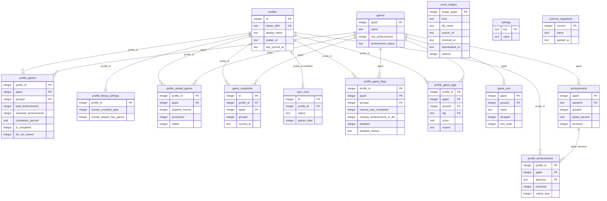

# Database

Developer reference for the SQLite layer in `internal/db` (`db.go`, `dsn.go`). The migration list in `db.go` is the sole source for creating and evolving the schema. Query code for these tables lives in `internal/repository` (see [repository.md](repository.md)). See [app-service.md](app-service.md) for where the app opens the database in its lifecycle, and [architecture.md](architecture.md) for the overall layering.

## Overview

- Driver: `github.com/mattn/go-sqlite3` (CGO). `go.mod` pins v1.14.x.
- One database file: `<data>/steam-achievement-tracker.db` (`config.DBFileName`), with `<data>` set to `appdata.Paths.DataDir`. Backups go in `<data>/backups/`.
- Privacy (GDPR): the database stays on the user's machine, and no database content is sent anywhere. Network use is Steam, and GitHub for updates (see [updater.md](updater.md#network) and the README "Data and privacy" section). The database never stores filesystem paths, since they carry the OS user name. `sync_runs.error` and `profile_games.last_error` hold only user-safe sentences (see [app-service.md](app-service.md#error-boundary)); migration 3 rewrote older rows. Pre-upgrade backups can still hold old data; see [Backup before migration](#backup-before-migration).
- Journal mode WAL. Foreign keys enforced.
- Connection pool capped at one open and one idle connection (`SetMaxOpenConns(1)`, `SetMaxIdleConns(1)`). Every query, including nested queries, shares that connection. Do not query `*sql.DB` while a transaction or an open `*sql.Rows` on the same handle remains in use; the query blocks forever. Repository code closes `rows` before issuing the next statement for this reason (see the comment on `loadGameCards`, and [repository.md](repository.md#repository-type)).
- Timestamps are stored as text. The repository writes `time.Now().UTC().Format(time.RFC3339)`. `SaveGameSync` takes its timestamp (`SyncedAt`) from the caller.

## Open flow

`OpenAndMigrate(paths appdata.Paths)` is the single entry point. The app calls it during `App` initialization, then constructs `repository.New(db)`.

1. `sqliteDSN(paths.DB)` builds the DSN (see below).
2. `sql.Open("sqlite3", dsn)`; `SetMaxOpenConns(1)`, `SetMaxIdleConns(1)`.
3. `Ping()`. The file is created here if missing.
4. `PRAGMA journal_mode=WAL`. Persistent for the file.
5. `secureDBFiles(paths)`: chmod `0600` on the DB, `-wal` and `-shm` files if they exist.
6. `migrate(conn, paths)`: see [Migrations](#migrations).
7. `secureDBFiles(paths)` again (WAL/SHM files may have been created by migration).
8. Return the connection. On any error before step 8 the connection is closed.

The DSN parameters apply to the single connection. WAL mode persists in the database file, so the `journal_mode` statement needs to succeed only once per open.

### DSN parameters and pragmas

| Setting | Where | Value | Notes |
| --- | --- | --- | --- |
| `_busy_timeout` | DSN (`sqliteParams`) | `5000` ms | go-sqlite3 sets SQLite busy timeout on open. |
| `_foreign_keys` | DSN (`sqliteParams`) | `on` | Foreign key enforcement for every connection. |
| `journal_mode` | `PRAGMA` in `OpenAndMigrate` | `WAL` | Executed once per open. |
| `user_version` | `PRAGMA` in migration code | schema version | Read in `inspectSchema`, set in `setUserVersion` inside the migration transaction. |
| `wal_checkpoint(TRUNCATE)` | `PRAGMA` in `backupDB` | | Run before copying the file for a backup. |
| `VACUUM`, `wal_checkpoint(TRUNCATE)` | `compact` | | Run after a compacting migration (migrations 2 and 3) commits, so the dropped path bytes and the rewritten text leave the files. |

No other pragmas are set. SQLite defaults remain in effect for `synchronous`, `cache_size`, `temp_store`, `auto_vacuum` and `secure_delete`.

## DSN rules (`dsn.go`)

`sqliteDSN(path)` selects the Windows rules when `runtime.GOOS == "windows"`; `sqliteDSNFor(path, windows)` is the testable core. It returns `<file URI>?_busy_timeout=5000&_foreign_keys=on`.

go-sqlite3 passes a `file:` DSN unchanged to `sqlite3_open_v2` with `SQLITE_OPEN_URI` set. SQLite then parses the query string itself; everything before the first `?` is the path. A raw `?` or `#` would terminate the path, and a raw `%` would be decoded, so the path is escaped accordingly.

`sqliteURIFile(path, windows)` follows the conversion steps in the SQLite URI documentation:

- Windows only: `\` becomes `/`. A drive-letter path gets a leading `/` (`C:/x` becomes `/C:/x`). Detected by `hasDriveLetter` (ASCII letter, `:`, `/`).
- Absolute path (leading `/`, which includes a UNC path `//server/share` on Windows) uses the `file://` form with an empty authority. Examples: `/home/u/x.db` gives `file:///home/u/x.db`; `/C:/x.db` gives `file:///C:/x.db`; UNC `//server/share/x.db` gives `file:////server/share/x.db`.
- Relative path uses the `file:` form.
- `escapeURIPath` percent-encodes every byte except ASCII letters, digits and `-._~/:`. This covers `%`, `?`, `#`, spaces, control characters and all non-ASCII UTF-8 bytes. Because the Linux path does not convert `\`, a backslash in a POSIX path is encoded as `%5C`.

Build DSNs only through `sqliteDSN`. Do not concatenate paths into DSN strings (per AGENTS.md; see the cases in `dsn_test.go`).

## Migrations

### Mechanism

- `migrations` is an ordered slice of `migration{version, name, sql, compact}` in `db.go`. Currently four entries: `{version: 1, name: "initial_schema", sql: initialSchemaSQL}`, `{version: 2, name: "cover_cached_flag", sql: coverCachedFlagSQL, compact: true}`, `{version: 3, name: "rewrite_stored_sync_text", sql: rewriteStoredSyncTextSQL, compact: true}` and `{version: 4, name: "add_lookup_indexes_and_prune_snapshots", sql: lookupIndexesAndPruneSnapshotsSQL}`.
- `latestVersion()` is the maximum `version` in that slice. A fully migrated database has `user_version = latestVersion()` and a `schema_migrations` row for every version.
- `schema_migrations(version integer primary key, name text not null, applied_at text not null)` is created by `ensureMigrationsTable` inside the migration transaction (`CREATE TABLE IF NOT EXISTS`). `applied_at` is UTC RFC3339.
- `inspectSchema` reads `PRAGMA user_version`, whether `schema_migrations` exists, whether any user table exists, and `max(version)` from `schema_migrations` (0 if absent). A failed query is returned as an error, never read as "absent": `tableExists` and `hasUserTables` return `(bool, error)`, and a database whose check fails is not treated as empty (which would skip the backup and run the baseline over existing data). The user-table check is `name not like 'sqlite_%'`. In SQL `LIKE`, `_` is a one-character wildcard, so the pattern also excludes names that start with `sqlite` followed by any single character; `LIKE` matching is ASCII case-insensitive. No table in the schema is affected.
- `migrate`:
  1. Read state.
  2. If `max(version, user_version) > latestVersion()`, return an error: `database schema version N is newer than this build supports (M)`. This runs before any backup or write. A newer database is never touched (downgrade protection).
  3. If `version >= target` and `schema_migrations` exists and `user_version >= target`, return. Nothing else runs.
  4. If the database has user tables, `backupDB` runs (see below). A new database (no user tables) is not backed up.
  5. Begin one transaction: create `schema_migrations` if needed; for each migration with `version > state.version` run its SQL, insert its `schema_migrations` row, and set `user_version` to that version; then set `user_version = target`; commit.
- Each migration's SQL and its bookkeeping are in the same transaction as the `user_version` bump. A failure rolls back and leaves the previous schema in place. Only an error from the migration's SQL is wrapped as `migration %03d %s: %w`. Errors from the `schema_migrations` insert or from setting `user_version` are returned unwrapped. All of them roll back the same way.
- The `initial_schema` SQL uses `CREATE TABLE IF NOT EXISTS` and `CREATE INDEX IF NOT EXISTS`. It creates the whole schema as it was at version 1, including `cover_images.path`. No upgrade path from pre-release layouts exists (the comment on `initialSchemaSQL` says so). Do not edit it: installed databases already ran it.
- Migration 2 `cover_cached_flag` (`coverCachedFlagSQL`) removes the absolute cover path, which held the OS user name:

  ```sql
  ALTER TABLE cover_images ADD COLUMN cached integer not null default 0;
  UPDATE cover_images SET cached = 1 WHERE path IS NOT NULL AND trim(path) <> '';
  ALTER TABLE cover_images DROP COLUMN path;
  ```

  `DROP COLUMN` needs SQLite 3.35 or newer; the bundled go-sqlite3 ships 3.54.
- Migration 3 `rewrite_stored_sync_text` (`rewriteStoredSyncTextSQL`, `compact: true`) rewrites stored error text. Versions before it stored the raw error in `profile_games.last_error` and `sync_runs.error`, and the UI shows both. The rule is an allowlist, not a pattern match:
  - a value that is exactly one of the sentences the app writes (the `steam.UserMessage` sentences, the usererr sentences, and the run texts `app restarted before sync completed` and `sync ended but its final status could not be saved`) is kept;
  - `sync_runs.error` also keeps the run summary `N of M games failed to sync`, where N and M are non-empty runs of digits and the value holds nothing else (checked by `partialRunSummarySQL`: `rtrim` on each number, and the fixed words by position, because a `GLOB` cannot require digits-only parts);
  - `context canceled` becomes `The request was canceled.`;
  - any other non-empty value becomes `Something went wrong. See the log file for details.`;
  - NULL and empty values are not changed.

  The list lives in the migration SQL (`syncTextSafeSentences`). It is append-only: new app sentences are added (see [Adding tests](testing.md#adding-tests)); entries are never removed or edited. It is not a pattern list because the raw texts vary (endpoints, status lines, URLs, decode messages) and an unlisted raw form would survive a pattern rule. The trade-off: a sentence that the app wrote in an earlier version and that is not on the list becomes the generic sentence. Re-running the migration SQL changes nothing. `compact` removes the old text from the free pages.
- `compact: true` on a migration means that after its transaction commits, `compact` runs `VACUUM` and then `PRAGMA wal_checkpoint(TRUNCATE)`. `VACUUM` cannot run inside the transaction. Without it the dropped or rewritten bytes stay in free pages and in the WAL. `compact` runs only when a compacting migration ran in this open and the database already had user tables before the open (a fresh install holds no dropped data, so it is skipped). A failure is logged as `migration committed; compact database: …` (path-redacted) and not returned: `OpenAndMigrate` succeeds, the migration itself stays committed, and `compact` is not retried on the next open. An incomplete `wal_checkpoint(TRUNCATE)` (busy, or log ≠ checkpointed frames) also counts as a failure. The dropped or rewritten bytes then stay in free pages and the WAL until SQLite reuses them or a later `VACUUM` runs.

- Migration 4 `add_lookup_indexes_and_prune_snapshots` (`lookupIndexesAndPruneSnapshotsSQL`, not compact) has two parts, in this order, in the migration transaction:
  1. Prune `game_snapshots` (`pruneSnapshotsSQL`). For each `(profile_id, appid, groupid)` it keeps the row with the highest `id` (the latest) and the row with the highest `id` among rows with `is_completed=1`, and deletes the rest. Order is by `id` (autoincrement), not `synced_at`. The readers need only whether a completed row exists, whether any row exists, and which appids have rows. The latest row is kept because it is the newest state of the entry. Nothing references `game_snapshots` by foreign key, so the delete fires no FK checks. Running the SQL again deletes nothing.
  2. Create the lookup indexes (`lookupIndexesSQL`, `CREATE INDEX IF NOT EXISTS`), listed under [Lookup indexes](#lookup-indexes-migration-4).
- Not compact: there is no `VACUUM` at startup. The pruned rows stay in free pages in the file until a later `VACUUM` or reuse. The data is not sensitive and nothing reads it.
- Downgrade is not supported. A database at version 4 is refused by older builds with the "newer than this build supports" error. The pre-upgrade backup is at version 3, so restoring it (with a build that opens version 3) is the only way back to the full history.
- Timing (development Linux machine, WAL): about 1 s at 1M snapshot rows for the prune and index SQL; about 1 s at 1M snapshot rows for `OpenAndMigrate`, including the pre-migration backup (`TestMigration4TimingAtOneMillionSnapshots`, run with `-v`). `OpenAndMigrate` runs during `ServiceStartup`, before the window opens.

### Backup before migration

Runs only when a migration is pending and the database already contains user tables.

- `backupDB` creates `<data>/backups` with `MkdirAll` and `Chmod` to `0700`.
- Runs `PRAGMA wal_checkpoint(TRUNCATE)`. Fails unless `busy == 0` and `log frames == checkpointed frames`, so the main file is complete before copying.
- Copies the main DB file (`paths.DB`) only; WAL and SHM are not copied, because the checkpoint emptied the WAL.
- Output: `<data>/backups/steam-achievement-tracker-<UnixNano>.db`, created with `O_EXCL` (never overwrites), mode `0600`, then `Sync()`, `Close()`, and `Chmod 0600` again.
- On copy or sync failure the partial file is removed after `Close` through `fsretry.Remove` (Windows cannot delete an open file). A file that could not be created is never removed.
- A backup failure (directory, checkpoint, copy) aborts the open: no migration runs and `OpenAndMigrate` returns the error.
- No retention or pruning. Backups accumulate; nothing in the code deletes them.
- The backup is not rolled back or restored automatically. A failed migration leaves the backup file behind for manual recovery.
- Backups keep data as it was before the upgrade: one made before migration 2 holds absolute cover paths (`cover_images.path`); one made before migration 3 holds raw `last_error` and `sync_runs.error` text, which can include request URLs with a SteamID64; one made before migration 4 holds the full `game_snapshots` history that migration 4 prunes. The app never reads or deletes backups; users must delete them from `<data>/backups/` (see the README "Data and privacy" section).

### Adding a migration

1. Add a SQL constant in `db.go` next to the other migration constants (for example `migrationV4SQL`). Use plain SQL. A migration may contain multiple statements, as the initial migration does.
2. Append an entry to `migrations`: `{version: 4, name: "descriptive_name", sql: migrationV4SQL}` (set `compact: true` only if the migration drops or rewrites data that must leave the file; migration 3 rewrites data and is marked compact). Use the next integer; keep versions contiguous and strictly increasing. `latestVersion()` takes the maximum, so a gap is not an error, but a gap is confusing.
3. Never edit `initialSchemaSQL` or any applied migration. Existing databases will not re-run it.
4. Update the table reference and mermaid diagram below, plus `repository.md` if query code changes.
5. Update tests that pin the current version or schema: `internal/db/db_test.go` and `db_gap_test.go` (version stamps, `user_version`, backup naming). Add a test that migrates a database at the previous version and checks the new rows and `user_version`.
6. Foreign keys: `_foreign_keys=on` is set on the connection. `PRAGMA foreign_keys` cannot be changed inside a transaction, and `migrate` opens its transaction before running any SQL. A migration that rebuilds a table (create new, copy, drop, rename) will fail on FK-referenced tables unless `migrate` is changed to turn foreign keys off before `Begin` and run `PRAGMA foreign_key_check` before commit. Additive changes (new table, new nullable or defaulted column, new index) need none of that.
7. A new migration makes the database version higher than older builds. An older build that opens it fails with the "newer than this build supports" error. This is intended.

## Schema reference

All tables are created by migration 1 (`initial_schema`), except `schema_migrations`, which `migrate` creates. Migration 2 changes only `cover_images` (its `path` column is replaced by `cached`). Migration 3 changes no columns; it rewrites the text in `profile_games.last_error` and `sync_runs.error`. Migration 4 changes no columns; it deletes older `game_snapshots` rows and adds indexes (see [Lookup indexes](#lookup-indexes-migration-4)). Columns are listed in definition order. "PK" is primary key; "FK" is foreign key. No `ON DELETE` or `ON UPDATE` actions are declared anywhere, so the default `NO ACTION` applies: deleting a referenced parent row fails while children exist. The repository deletes children first (see `ClearProfileData` in [repository.md](repository.md)). Besides primary keys, `NOT NULL` and foreign keys, the only uniqueness constraint is `UNIQUE` on `profiles.steam_id64`. There are no `CHECK` constraints.

### `settings`

Key-value store for app-level settings.

| Column | Type | Null | Key | Notes |
| --- | --- | --- | --- | --- |
| `key` | text | no | PK | |
| `value` | text | no | | |

Used keys:

- `active_profile_id`. Value is the decimal `profiles.id`, or the empty string meaning no active profile. A missing row also means no active profile. See [repository.md](repository.md#settings-keys).
- `update_checks_enabled`. `1` (on) or `0` (off), app-wide; a missing row means on. Added without a migration. Read/write rules: [repository.md](repository.md#update-check-setting), [updater.md](updater.md#persistence).

### `schema_migrations`

Created by `migrate`, not by a migration.

| Column | Type | Null | Key | Notes |
| --- | --- | --- | --- | --- |
| `version` | integer | no | PK | Migration version. |
| `name` | text | no | | Migration name, e.g. `initial_schema`. |
| `applied_at` | text | no | | UTC RFC3339. |

### `profiles`

One row per connected Steam account. Removing a profile without **Delete profile data** keeps its row, so connecting the same SteamID64 again restores its data (see [app-service.md](app-service.md)).

| Column | Type | Null | Key | Notes |
| --- | --- | --- | --- | --- |
| `id` | integer | no | PK, autoincrement | |
| `steam_id64` | text | no | UNIQUE | |
| `display_name` | text | no | | |
| `avatar_url` | text | yes | | |
| `created_at` | text | no | | |
| `updated_at` | text | no | | |
| `last_synced_at` | text | yes | | Set by `TouchProfileSynced`. |

### `games`

Shared Steam app metadata. Not per profile.

| Column | Type | Null | Key | Default | Notes |
| --- | --- | --- | --- | --- | --- |
| `appid` | integer | no | PK | | |
| `name` | text | no | | | |
| `has_achievements` | integer | no | | `0` | Bool. |
| `achievement_status` | text | no | | `'unknown'` | Set by sync: `unknown` (default, until a successful game sync), `ok`, or `no_achievements`. |
| `created_at` | text | no | | | |
| `updated_at` | text | no | | | |

### `game_sets`

Achievement-set catalogue of a game. One row per `(appid, groupid)`. Not per profile.

| Column | Type | Null | Key | Default | Notes |
| --- | --- | --- | --- | --- | --- |
| `appid` | integer | no | PK (part), FK to `games.appid` | | |
| `groupid` | integer | no | PK (part) | | `0` is the base game; other groupids are DLC or named sets. |
| `name` | text | no | | `''` | Set name from Steam. |
| `dlcappid` | integer | no | | `0` | Non-zero when the set is bound to a DLC app. |
| `sort_order` | integer | no | | `0` | |
| `updated_at` | text | no | | | |

### `cover_images`

Cached cover state per image app id (the game, or the DLC app id for DLC sets). No foreign keys: the id may refer to a DLC that has no `games` row.

| Column | Type | Null | Key | Notes |
| --- | --- | --- | --- | --- |
| `image_appid` | integer | no | PK | |
| `kind` | text | no | | `library`, `hero`, `header`, `main`, or `''` (checked, no cover). |
| `file_name` | text | no | | One of the cache file names, or `''`. |
| `source_url` | text | yes | | |
| `cached` | integer | no | | `1` when a cover file exists under `<GameImages>/<image_appid>/<file_name>`, `0` when none. Added by migration 2 (default 0). No file path is stored. |
| `checked_at` | text | yes | | Last check, set on every save. |
| `downloaded_at` | text | yes | | Last successful download. Drives `?v=` cache-busting in the URL. |

### `profile_games`

One row per profile entry: `(profile, app, groupid)`. This is the dashboard card table. Stats and completion state.

| Column | Type | Null | Key | Default | Notes |
| --- | --- | --- | --- | --- | --- |
| `profile_id` | integer | no | PK (part), FK to `profiles.id` | | |
| `appid` | integer | no | PK (part), FK to `games.appid` | | |
| `groupid` | integer | no | PK (part) | `0` | |
| `total_achievements` | integer | no | | `0` | |
| `unlocked_achievements` | integer | no | | `0` | |
| `completion_percent` | real | no | | `0` | |
| `missing_avg_unlock` | real | yes | | | Average global unlock percent of missing achievements. |
| `suggestion_score` | real | yes | | | |
| `is_completed` | integer | no | | `0` | |
| `was_completed` | integer | no | | `0` | Set by sync, or recomputed by `MarkGamePreviouslyCompleted`. |
| `newly_incomplete` | integer | no | | `0` | Previously completed, now incomplete. |
| `sync_warning` | integer | no | | `0` | Latest sync for this entry failed. |
| `dlc_not_owned` | integer | no | | `0` | DLC-bound set whose DLC the profile does not own. |
| `last_error` | text | yes | | | |
| `last_error_at` | text | yes | | | |
| `last_synced_at` | text | yes | | | NULL when the entry was never successfully synced. |

### `profile_owned_games`

Per-profile facts about a game in that profile's library.

| Column | Type | Null | Key | Default | Notes |
| --- | --- | --- | --- | --- | --- |
| `profile_id` | integer | no | PK (part), FK to `profiles.id` | | |
| `appid` | integer | no | PK (part), FK to `games.appid` | | |
| `playtime_forever` | integer | no | | `0` | Minutes, as Steam reports. |
| `purchased` | integer | no | | `0` | In the purchased list. |
| `vetted` | integer | no | | `1` | `0` when Steam returns the app only with unvetted apps included. |
| `updated_at` | text | no | | | |

### `profile_library_settings`

Library sync options per profile. A profile without a row uses `DefaultLibrarySettings()` (both on).

| Column | Type | Null | Key | Default | Notes |
| --- | --- | --- | --- | --- | --- |
| `profile_id` | integer | no | PK, FK to `profiles.id` | | |
| `include_unvetted_apps` | integer | no | | `1` | |
| `include_played_free_games` | integer | no | | `1` | |
| `updated_at` | text | no | | | |

### `achievements`

Shared achievement definitions per app. Global unlock percentage and archive flag.

| Column | Type | Null | Key | Default | Notes |
| --- | --- | --- | --- | --- | --- |
| `appid` | integer | no | PK (part), FK to `games.appid` | | |
| `apiname` | text | no | PK (part) | | Steam API name. |
| `groupid` | integer | no | | `0` | Set the achievement was last synced under. |
| `global_percent` | real | yes | | | |
| `archived` | integer | no | | `0` | Archived achievements are excluded from counts. |
| `updated_at` | text | no | | | |

### `profile_achievements`

Per-profile unlock state of a shared achievement.

| Column | Type | Null | Key | Default | Notes |
| --- | --- | --- | --- | --- | --- |
| `profile_id` | integer | no | PK (part), FK to `profiles.id` | | |
| `appid` | integer | no | PK (part) | | |
| `apiname` | text | no | PK (part) | | |
| `unlocked` | integer | no | | `0` | |
| `unlock_time` | integer | yes | | | Steam unlock time. |
| `updated_at` | text | no | | | |

Composite FK: `(appid, apiname)` references `achievements(appid, apiname)`.

### `game_snapshots`

History of entry state: one row per entry each time its state changes (total, unlocked or completed) on a successful game sync. A sync that finds the latest snapshot unchanged adds no row. Migration 4 pruned the table to the latest row and the latest completed row per `(profile_id, appid, groupid)`, so older rows are gone. Used to derive `was_completed` for entries whose `profile_games` row was later pruned. `MarkGamePreviouslyCompleted` also reads it (see [repository.md](repository.md#flag-methods)) to compute `was_completed` and `newly_incomplete` for an existing entry.

| Column | Type | Null | Key | Default | Notes |
| --- | --- | --- | --- | --- | --- |
| `id` | integer | no | PK, autoincrement | | |
| `profile_id` | integer | no | FK to `profiles.id` | | |
| `appid` | integer | no | FK to `games.appid` | | |
| `groupid` | integer | no | | `0` | |
| `total_achievements` | integer | no | | | |
| `unlocked_achievements` | integer | no | | | |
| `completion_percent` | real | no | | | |
| `missing_avg_unlock` | real | yes | | | |
| `is_completed` | integer | no | | | |
| `synced_at` | text | no | | | |

Apart from migration 4's one-time prune, rows are removed only by `ClearProfileData`. The table grows with every state change (not with every sync).

### `sync_runs`

One row per sync run.

A `running` row with no live sync is one whose final status could not be saved (`FinishSyncRun` failed). The app reports that run as `failed` with a stale-run message when it reads the row, and leaves the row as it is. The next app start sets such rows to `canceled` (`CancelRunningSyncRuns`). See [syncer.md](syncer.md#run-statuses).

| Column | Type | Null | Key | Default | Notes |
| --- | --- | --- | --- | --- | --- |
| `id` | integer | no | PK, autoincrement | | |
| `profile_id` | integer | yes | FK to `profiles.id` | | |
| `started_at` | text | no | | | |
| `finished_at` | text | yes | | | |
| `status` | text | no | | | `running` at start, then `success`, `partial` or `failed` (written by the syncer), or `canceled` (written by `CancelRunningSyncRuns` on restart). |
| `games_total` | integer | no | | `0` | |
| `games_synced` | integer | no | | `0` | |
| `games_failed` | integer | no | | `0` | |
| `error` | text | yes | | | |

### `profile_game_flags`

User flags and disables per entry. Kept by pruning, so flags survive when an entry's sets are removed from Steam.

| Column | Type | Null | Key | Default | Notes |
| --- | --- | --- | --- | --- | --- |
| `profile_id` | integer | no | PK (part), FK to `profiles.id` | | |
| `appid` | integer | no | PK (part), FK to `games.appid` | | |
| `groupid` | integer | no | PK (part) | `0` | |
| `manual_was_completed` | integer | no | | `0` | User-set "previously completed". Toggled by `MarkGamePreviouslyCompleted`. |
| `missing_achievements_in_dlc` | integer | no | | `0` | User flag marking that the entry's achievements are missing from the set and live in a DLC. Toggled by `ToggleMissingAchievementsInDLC`. |
| `disabled` | integer | no | | `0` | |
| `disabled_reason` | text | yes | | | `manual` or `not_owned`. |
| `created_at` | text | no | | | |
| `updated_at` | text | no | | | |

Index: `idx_profile_game_flags_profile_disabled (profile_id, disabled)`.

### `profile_game_tags`

Cached dashboard tags per entry, recomputed by the repository. See [repository.md](repository.md#tag-model).

| Column | Type | Null | Key | Notes |
| --- | --- | --- | --- | --- |
| `profile_id` | integer | no | PK (part), FK to `profiles.id` | |
| `appid` | integer | no | PK (part), FK to `games.appid` | |
| `groupid` | integer | no | PK (part) | |
| `tag` | text | no | PK (part) | Tag name. |
| `score` | real | yes | | Set only for `in_progress` and `almost_there`. |
| `reason` | text | yes | | Human-readable reason. |
| `computed_at` | text | no | | |

Index: `idx_profile_game_tags_profile_tag (profile_id, tag)`.

### Lookup indexes (migration 4)

Created by migration 4 with `CREATE INDEX IF NOT EXISTS`. Each serves a lookup that otherwise scans a whole table (the profile-leading primary keys do not cover appid lookups). Names follow `idx_<table>_<cols>`.

| Index | Columns | Used by |
| --- | --- | --- |
| `idx_profile_achievements_appid_apiname` | `profile_achievements(appid, apiname)` | Orphan checks for `achievements` and `games`, and the foreign key check when an `achievements` row is deleted. |
| `idx_profile_games_appid` | `profile_games(appid)` | `HasSetData`, the `game_sets` orphan delete, the `games` orphan check, and the foreign key check when a `games` row is deleted. |
| `idx_profile_owned_games_appid` | `profile_owned_games(appid)` | Orphan check for `games`. |
| `idx_profile_game_flags_appid` | `profile_game_flags(appid)` | Orphan check for `games`. |
| `idx_profile_game_tags_appid` | `profile_game_tags(appid)` | Orphan check for `games`. |
| `idx_game_snapshots_appid` | `game_snapshots(appid)` | Orphan check for `games`. |
| `idx_game_snapshots_profile_id_appid_groupid_is_completed` | `game_snapshots(profile_id, appid, groupid, is_completed)` | `MarkGamePreviouslyCompleted`, `profileGameHistory`, profile removal, and the latest-row dedupe lookup in `SaveGameSync` (its leading three columns). |
| `idx_game_sets_dlcappid` | `game_sets(dlcappid)` | DLC branch of the cover lookups: `entriesForImageAppSQL` and `orphanCoverRowsSQL` (`repository/covers.go`, `repository/cleanup.go`). |
| `idx_sync_runs_profile_id` | `sync_runs(profile_id)` | `LatestSyncRun`, profile removal. |

`TestLookupQueriesUseIndexes` checks the query plans (`EXPLAIN QUERY PLAN` shows `SEARCH ... USING INDEX`). The orphan deletes in `cleanup.go` are checked by `TestCleanupQueriesUseIndexes` in `internal/repository`, against the shipped SQL.

### Relationships

Logical links with no foreign key declared: `game_sets(appid, groupid)` joins `profile_games(appid, groupid)`; `cover_images.image_appid` maps to `game_sets.dlcappid` or `profile_games.appid`; `profile_game_flags` and `profile_game_tags` are keyed like `profile_games` but do not reference it.

### ER diagram



`settings`, `cover_images` and `schema_migrations` have no declared relationships.

## Invariants

- `user_version` equals the highest applied migration version after a successful open, and every applied version has a `schema_migrations` row.
- A database newer than the build is never modified. The check runs before backup and before any write.
- Each migration and its bookkeeping commit atomically with the `user_version` bump.
- At most one connection is open per `*sql.DB`. No nested queries while a transaction or `rows` cursor is open.
- `games` rows are shared. Per-profile state lives only in `profile_*` tables. `ClearProfileData` removes a `games` row only when nothing in the database references it (`deleteOrphanRowsForAppIDs`).
- `profile_games` and `profile_game_flags` are separate on purpose: pruning an entry (a set Steam no longer reports) deletes the `profile_games` row and its tags, but keeps the flags and snapshots.
- A `cover_images` row with `cached = 1` refers to a file under `<GameImages>/<image_appid>/<file_name>` (see [covers.md](covers.md)). The database never stores filesystem paths: the file is found from the image id and file name only.
- Disabled entries have no `profile_game_tags` rows. Every path that disables an entry deletes its tags, and recompute returns early (after deleting) for disabled entries.
- Database files and backups are restricted to the owner where the OS supports it: directories `0700`, DB, WAL, SHM, backup files `0600`. Windows ignores these bits; ACLs apply.
- Backups are written only before a migration on a database that already has user tables. They are never deleted automatically.
