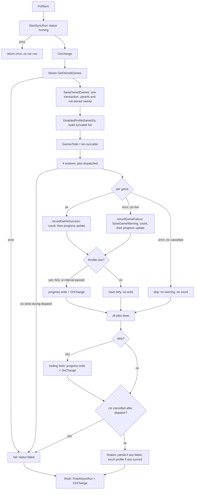
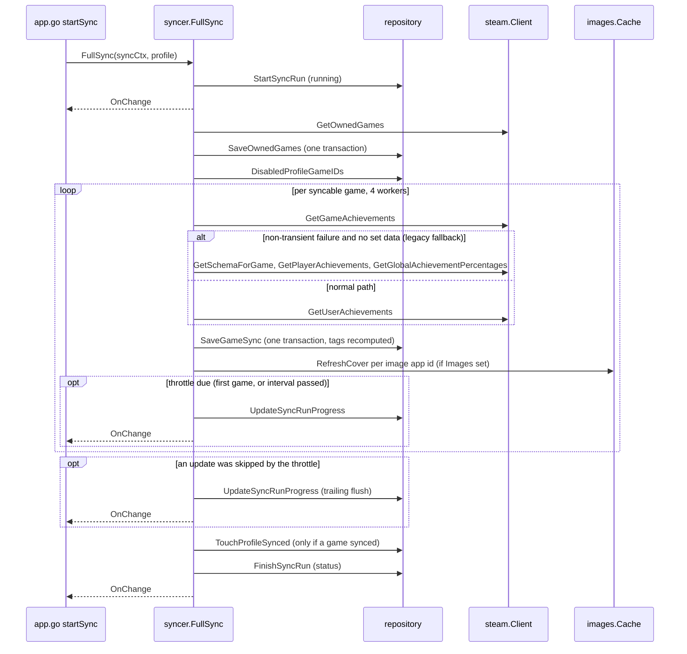

# Syncer (`internal/syncer`)

The syncer runs one full sync for a profile: it loads the profile's library from Steam, refreshes each syncable game's achievement sets, writes results through the repository, refreshes covers, and records the run status. Source: `internal/syncer/syncer.go`. Tests: `internal/syncer/*_test.go`.

The syncer does not own goroutines or cancellation. `app.go` (`startSync`) creates the context, starts `FullSync` in a goroutine, and wires notifications. See [app-service.md](app-service.md). The syncer's database reads and writes go through `internal/repository` (see [repository.md](repository.md) and [database.md](database.md)). Steam requests go through `internal/steam` (see [steam-client.md](steam-client.md)). Cover files go through `internal/images` (see [covers.md](covers.md)).

## Public API

```go
type Service struct {
    Repo   *repository.Repository
    Steam  *steam.Client
    Images *images.Cache   // nil disables cover refresh
    OnChange func()        // nil-safe; see Progress and change notifications
    ProgressInterval time.Duration // min time between progress writes; 0 = 500 ms, negative = no throttling
}

type Result struct {
    GamesTotal  int
    GamesSynced int
    GamesFailed int
    Status      string   // success, partial or failed (see Run statuses)
    Error       *string  // summary (partial) or error text (failed)
}

func (s *Service) FullSync(ctx context.Context, profile repository.Profile) (Result, error)
```

`FullSync` returns `(Result, error)`. The error is non-nil only when the run fails (or cannot start; see below); a partial run returns a nil error. The run row is written either way.

Everything else in the file is unexported. Exported values from other packages used here: `repository.Profile`, `steam.OwnedGame`, `steam.Client` methods, `images.Cache` methods.

## Run lifecycle



The same flow as a sequence, with the external calls:



`FullSync` steps:

1. `Repo.StartSyncRun` inserts a `sync_runs` row with status `running`. On error, `FullSync` returns immediately: no row, no `OnChange`, no status.
2. `OnChange` is called once the row exists.
3. `prepareOwnedGames`: `Steam.GetOwnedGames`, then `Repo.SaveOwnedGames` with the whole list. It upserts each game (playtime, purchased, vetted, name) and runs the not-owned sweep in one transaction. A `GetOwnedGames` error fails the run and changes no game, flag or tag row (the run row itself ends `failed`). A database error from `SaveOwnedGames` fails the run too (see [Failure handling](#failure-handling)): the transaction rolls back, so nothing is written and no game is synced.
4. `Repo.DisabledProfileGameIDs` lists apps to skip; `syncableGames` drops them. The run's `GamesTotal` is set to the size of the remaining list.
5. `syncGames` starts 4 worker goroutines (a literal `4` in `syncGames`), dispatches every syncable game on an unbuffered channel, closes the channel, and waits for the workers.
6. `finalize` sets status `partial` when any game failed, and calls `TouchProfileSynced` when at least one game succeeded.
7. `finish` writes the final status, error and counts with `Repo.FinishSyncRun`, then calls `OnChange`.

Failure of the whole run goes through `fail(err)`: status `canceled` when `errors.Is(err, context.Canceled)`, otherwise `failed`. The stored error text is `steam.UserMessage(err)` (a cancelled run stores `The request was canceled.`). A run that synced at least one game touches the profile's `last_synced_at` here too, as `finalize` does. Then `finish`. The raw `err` is returned to the caller, which logs it.

A panic is a run failure too. `FullSync` recovers it in a deferred function and ends the run through `fail`, as `failed` with the generic sentence `Something went wrong. See the log file for details.` A panic in one game is recovered per game (see [Worker pool](#worker-pool-and-per-game-failures)). The panic value and a stack trace go to the log only, with secrets scrubbed by `steam.RedactSecrets` (paths are kept, as in `callBound`; release builds use `-trimpath`).

`GamesTotal` reaches the row through `UpdateSyncRunProgress`, and through `FinishSyncRun`. Progress writes are throttled (see [Progress and change notifications](#progress-and-change-notifications)): the first finished game writes at once, so `games_total` becomes visible as soon as that game finishes, and later games write at most once per `ProgressInterval` (500 ms by default). A run with no syncable games, or one that fails before any game finishes, gets its total only from `FinishSyncRun`.

## Run statuses

Status values stored in `sync_runs.status`:

| Status | Written by | Decided by |
| --- | --- | --- |
| `running` | `Repo.StartSyncRun` | Row created at start of `FullSync`. Stays until `FinishSyncRun`. |
| `success` | `finalize` (default) | No failed game and no run-level error. A run with zero syncable games is also `success`. |
| `partial` | `finalize` | At least one game failed (`GamesFailed > 0`), including when every game failed. `Error` reads `N of M games failed to sync`. |
| `failed` | `fail` | Run-level error that is not a cancel: `GetOwnedGames` or the disabled-game lookup failed, a deadline passed, or the run panicked. `Error` is `steam.UserMessage(err)`. |
| `canceled` | `fail` (a cancel during the run, see [Cancellation](#cancellation)); `Repo.CancelRunningSyncRuns` at app start | `fail` writes it for `context.Canceled`, in dispatch or after all games were dispatched. `Error` is `The request was canceled.`. `CancelRunningSyncRuns` marks rows still `running` after an unclean exit, with the app's own reason. |

Games interrupted by cancellation are not counted and do not get warnings. A canceled run that synced games keeps `games_synced` and touches the profile's `last_synced_at`.

If `FinishSyncRun` itself fails, the error is logged and the row stays `running`. The app then reports that run as `failed` with a stale-run message, without changing the row (see [app-service.md](app-service.md)).

## Worker pool and per-game failures

- Workers run `syncWorker`, which calls `syncGame` for each job. A nil error calls `recordGameSuccess`.
- A non-nil error when the context is still live calls `recordGameFailure`: it formats the warning (`repository.FormatGameError`) with the cause of the error (`usererr.LogText`, paths reduced, then `steam.RedactSecrets` so a key or SteamID64 in the cause is not logged) and logs it, calls `Repo.SaveGameWarning` with `steam.UserMessage(err)` (the user-safe sentence shown in Sync errors), increments `GamesFailed`, and then runs the progress update (throttled).
- A non-nil error when the context is cancelled is neither a success nor a failure: no warning, no count. The game keeps its stored data.
- `syncGameSafely` wraps `syncGame` in a `recover`. A panic becomes that game's error (`panicError`, text `panic: <value>` for the log only) and goes through the same `recordGameFailure` path, so the worker continues with the next game. A worker that died would leave `dispatchSyncJobs` blocked on the unbuffered jobs channel. The panic is logged with its stack, with secrets scrubbed.
- `syncJob` wraps one job (the sync and its bookkeeping: `recordGameFailure` and `recordGameSuccess` call the repository and `OnChange`) in a second, log-only `recover`. A panic there is logged as `appid <id>: worker panic:` and records no game failure, so the worker takes the next game and the run still finishes. If the panic happens inside `recordGameFailure` before the failure is counted, that game counts as neither synced nor failed and the run can still end `success` without a warning. The trailing progress flush in `syncGames` runs outside the per-game guard, so a panic there (for example from `OnChange`) ends the run `failed` via `FullSync`'s recover instead of being logged as a worker panic.
- Two locks. `r.mu` guards only the counters and is never held across DB I/O or `OnChange`. `progressMu` orders progress: under it the run decides whether a write is due, then takes the counter snapshot (under `mu`) and writes, so the row receives writes in decision order and each write holds the latest counts. `progressMu` is taken before `r.mu`, never the reverse. `OnChange` runs after `progressMu` is released.

## Per-game refresh

`syncGame(ctx, profile, game)` refreshes one game. Each step below is in `internal/syncer/syncer.go`.

1. `Steam.GetGameAchievements(appID)`. On error:
   - `shouldFallbackToLegacy` decides whether to switch to the legacy path. It returns true only for an `*steam.HTTPStatusError` whose code is not transient (429, 500, 502, 503, 504 are transient), or for an `*steam.EResultError`. Transport, context and decode errors never fall back. Unrelated errors return `achievement schema: <err>`.
   - Fallback is refused when the game already has set data (`Repo.HasSetData`), because the legacy path writes one group-0 entry and prunes all others. In that case the error surfaces and existing entries are kept.
   - Otherwise `syncGameLegacy` runs: `GetSchemaForGame`, `GetPlayerAchievements`, `GetGlobalAchievementPercentages`, one group-0 entry from `buildAchievementStats`. Legacy code is marked for removal together with the legacy client methods. If `GetSchemaForGame` returns an empty list, `syncGameLegacy` calls `saveGameWithoutAchievements` (step 2).
2. If the schema has no achievements (EResult 42 or an empty list), `saveGameWithoutAchievements` first checks for stored data. It is any entry of the game with `groupid<>0`, any entry with achievements (`total_achievements>0`), or `games.has_achievements=1` (`Repository.HasStoredAchievementData`). If there is stored data, nothing is written or pruned and the game fails with `steam.ErrNoAchievementsReturned` (`Steam did not return achievements for this game. Try again later.`): a warning, so the run ends `partial`. Without stored data it writes the game as `no_achievements` with a group-0 entry only, then refreshes the game's cover. The legacy path uses the same guard.
3. `Steam.GetUserAchievements(steamID64, appID)`. Failure returns `user achievements: <err>`.
4. `buildSetEntries(appID, schema, user)` builds one `setEntry` per eligible set (see below).
5. `saveEntries` builds a `repository.SetSyncUpdate` per entry, comparing each against its previous state (`Repo.ProfileGame`), then calls `Repo.SaveGameSync` in one transaction, then refreshes the covers of the game and its entries' image ids.

Entries may be empty (the game has achievements but none is eligible). That is written as-is: every entry of the game is deleted (see [Set eligibility](#set-eligibility-and-entries)).

### What `SaveGameSync` writes

One transaction in `internal/repository/games.go`; steps in [repository.md](repository.md#savegamesyncgamesyncupdate-error). `game_sets` rows are only upserted (see [Surprising behaviour](#surprising-behaviour)).

## Set eligibility and entries

`buildSetEntries` takes the schema (`steam.GameAchievements`) and the user state (`steam.UserAchievements`):

- Achievements are grouped by `GroupID`. `withDefaultSets` adds a default set (public, no DLC, no name) for each groupid that has achievements but no `Sets` metadata. Default sets follow the Steam sets, in ascending groupid order.
- Sets are walked in schema order. Only a set that passes `setEligible` marks its groupid as seen, so the first eligible set wins for duplicates. An eligible set with no countable achievement still marks its groupid seen, so a later duplicate is skipped too.

| Rule | Effect |
| --- | --- |
| `set.Archived` | Set skipped (`setEligible`). |
| `set.DeveloperOnly` | Set skipped. |
| `!set.Public` | Set skipped. |
| No non-archived achievement in the set | Set skipped (`buildSetEntry` returns no entry). |
| `set.DLCAppID != 0` | Image id is the DLC id; otherwise the game id. |
| DLC not owned (`dlcNotOwned`) | Entry kept, flagged `DLCNotOwned`. The set's groupid is non-zero, `DLCAppID` is non-zero, the groupid is absent from `user.Groups`, and no achievement in the set is unlocked. |

DLC ownership is inferred, not read directly. The profile owns a DLC set when Steam lists its groupid in the user response or any of its achievements is unlocked. A DLC set that is not owned is kept, so it can show the `dlc_not_owned` tag. Once owned, the next sync clears the flag.

Each entry records every achievement, including archived ones (for the record). Only non-archived achievements count toward totals and completion.

## Completion, score and flags

For each entry (`buildSetEntry`, `statsTally`, `setSyncUpdate`):

- `total` = non-archived achievements; `unlocked` = non-archived achievements the profile has unlocked.
- `completion` = `unlocked / total * 100`, or 0 when total is 0.
- `missingAvg` = mean of `GlobalPercent` over non-archived locked achievements that have a global percent; nil when none does.
- `isCompleted` = `total > 0 && unlocked == total`. Locked archived achievements never block completion.
- `score` (`suggestionScore`) = `completion * 0.5 + missingAvg * 0.5`, or `completion * 0.5` when `missingAvg` is nil. Stored in `profile_games.suggestion_score` on the achievement path. On the no-achievements path it is left NULL.

The repository repeats the same formula in `suggestionScoreOrFallback`, used only when a stored score is NULL. The two must be kept in step.

The "was" and "newly incomplete" flags (`wasEverCompleted`, `wasEverCompletedNow`, `newlyIncomplete`):

- `was_completed` = previously `was_completed`, or previously `is_completed`, or the manual "previously completed" flag, or `isCompleted` now.
- `newly_incomplete` is true when the entry is not complete now and either:
  - it was `newly_incomplete` before, or the manual "previously completed" flag is set; or
  - it existed before, had been completed (`was_completed` or `is_completed`), and the total now exceeds the stored `total_achievements` (new achievements were added).
- Once the entry completes again, `newly_incomplete` clears. The "new achievements" branch needs a stored previous row, so a first sync never sets it.
- `saveGameWithoutAchievements` (the no-achievements path) sets `was_completed` from the previous state, but `newly_incomplete` only from the manual flag (`prev.ManualWasCompleted`). The new-achievements branch is not evaluated there, so a `newly_incomplete` flag from an earlier sync is cleared when the game turns `no_achievements`.

`repository.MarkGamePreviouslyCompleted` also sets these flags directly from snapshots and manual flags when the user acts on a card.

### Tags

The syncer does not compute tags; `repository.recomputeGameTagsTx` does, inside the same transaction as `SaveGameSync`, `SaveGameWarning` and `SaveCover`. Because covers are saved after `SaveGameSync`, `SaveCover` is what clears `missing_cover_art` when a cover arrives. Rules and triggers: [repository.md](repository.md#tag-model).

## Disabled games and "no longer owned"

- `DisabledProfileGameIDs` returns app ids that have a disabled flag (entry-level or `not_owned`) and no entry left enabled. An app with at least one enabled entry stays in the sync, so its enabled sets keep updating. A disabled flag with no `profile_games` row for the app skips the app only when its reason is `not_owned`.
- Apps in that list are removed before the workers start and are not counted in `GamesTotal`. A game whose sets are all disabled is therefore not refreshed, which means new DLC sets are only discovered after one of its sets is re-enabled.
- The not-owned sweep (the same transaction as the owned-list upserts, `SaveOwnedGames`) runs after every successful `GetOwnedGames`. For each entry of a game the profile no longer owns it sets `disabled=1` with reason `not_owned`. A `manual` disable keeps its reason, so re-owning a game does not re-enable it. A `not_owned` flag is cleared when the game is owned again. Tags of absent games are deleted.
- An empty owned list disables every entry of the profile as `not_owned`. `steam.Client.GetOwnedGames` accepts an explicit `game_count` of 0 as a valid empty library, so an empty answer from Steam has this effect.

## Failure handling

| Failure | Result |
| --- | --- |
| `GetOwnedGames` error | Run `failed`. No game rows changed. |
| Owned-list save error (`SaveOwnedGames`: upserts or not-owned sweep) | Logged as `save owned games`. Run `failed` with the generic sentence. The transaction rolls back: no owned-list, flag or tag row changes, and no game is synced. |
| Game schema error (non-fallback) | Game `SaveGameWarning` with the user-safe text from `steam.UserMessage`. |
| Game user-achievement error | Same as above. |
| Legacy fallback with existing set data | Refused; game warning. Existing entries kept. |
| Store or cover error | Logged by the cover refresh. Game sync still succeeds. |
| `SaveGameSync` error | Game warning; the transaction is rolled back, so the previous data stays. |

Stored and displayed error text is always user-safe. `recordGameFailure` stores `steam.UserMessage(err)` as the game warning, and `fail` stores `steam.UserMessage(err)` as the run error, so a database or filesystem error stores `Something went wrong. See the log file for details.`. `fail` picks the status (`canceled` for `context.Canceled`), and `steam.UserMessage` gives `The request was canceled.` for it, also inside a `*url.Error`. A panic stores the generic sentence (see [Run statuses](#run-statuses)). The raw error is only logged: a game line through `repository.FormatGameError` with the sentence and the cause (`usererr.LogText`, paths reduced, then `steam.RedactSecrets`), a run line in `app.go` (`full sync failed`) with the same (`logText`), the other sync log lines (`save owned games`, `save game warning`, `update sync progress`, `finish sync run`, and so on) and a cover line through `redact.Paths`. Cover refresh errors are never stored. The `partial` run text `N of M games failed to sync` is built from counts, not from error text.

`SaveGameWarning` keeps prior data: it sets `sync_warning` and `last_error` on existing entries and does not change totals. A game with no entries gets a group-0 placeholder with no progress. Details: [repository.md](repository.md#savegamewarningprofileid-gamerecord-warning-string-error).

A run that ends `partial` still updates `last_synced_at` for the profile when at least one game succeeded. A run where every game failed is `partial` with `games_synced` 0, and the profile's `last_synced_at` is not touched. A `failed` or `canceled` run touches it the same way, when at least one game succeeded before the run ended.

**Side effect of the empty-schema guard:** a game whose developer really removed every achievement, with stored data, stays `partial` on every sync (one warning per entry, `Steam did not return achievements for this game. Try again later.`). Its stored entries are kept, and the warning clears only when Steam returns a schema again. Because `games.has_achievements` is shared across profiles, a newly added profile also gets that permanent warning for such a game (as a placeholder entry), not only profiles with stored data. The fix would be to store a "schema removed" state once Steam confirms an empty schema twice in a row; that is not implemented.

Per-game warnings are cleared by the next successful sync of that game (`SaveGameSync` writes `sync_warning` 0 for each entry it writes). The tests for this are `TestFullSyncClearsWarningAfterRecovery` and `TestFullSyncRecordsPartialFailureAndKeepsSuccessfulGame` in `syncer_test.go`.

## Cancellation

- The sync context is derived from the app lifetime context in `startSync`. Two app paths cancel a running sync: `ServiceShutdown` (cancels the lifetime context and the sync's cancel func) and `ClearActiveUserData` (calls `cancelSyncAndWait` before removing the profile). No other user action cancels a sync.
- `dispatchSyncJobs` stops handing out work when the context is done and returns `ctx.Err()`.
- A game interrupted by cancellation is not warned and not counted. Its stored data stays as it was. Steam requests honour the context, so workers stop quickly.
- After the workers finish, `syncGames` returns `ctx.Err()` when cancellation happened after the last job was handed off. Without this check, the run would end as `success`.
- A cancellation (`context.Canceled`, also inside a `*url.Error`) makes the run `canceled`; the stored text is `steam.UserMessage(err)`, i.e. `The request was canceled.`
- A deadline (`context.DeadlineExceeded`) is not a user cancel: the run is `failed`, with the network sentence (`Could not reach Steam. ...`). No code path sets a deadline on the sync today.

## Progress and change notifications

`Service.OnChange` is called from the sync goroutine and the worker goroutines, so it must be goroutine-safe. It is never called while any run lock (`mu` or `progressMu`) is held.

Progress writes are throttled. Counters in `r.result` are always updated at once. Only the write and its `OnChange` are throttled.

- A game update (`updateProgress`) writes when no progress write has happened in this run yet, or when at least `ProgressInterval` has passed since the last write attempt. `ProgressInterval` is zero for the default, 500 ms. A negative value turns throttling off: every finished game writes. The clock is `Service.now` (nil means `time.Now`); tests drive it by hand.
- A game update that is throttled does not write and does not call `OnChange`. It marks the run dirty.
- When the workers are done (`syncGames`, after `wg.Wait`), a dirty run gets one trailing flush: a progress write and `OnChange`. This keeps the row at the final counters if `FinishSyncRun` then fails, and gives a canceled run accurate counts. A run with nothing dirty gets no extra write.
- A write that fails still counts as an attempt for the throttle (a broken DB is not hit once per game). Its error is logged as `update sync progress`.
- Consequence: a throttled count shows in the row only after the next write. If the next finished game is far off, the row can lag until then, or until the trailing flush or `FinishSyncRun`.

`OnChange` fires at:

1. after `StartSyncRun` succeeds, before the library fetch;
2. after each progress write that the throttle allows (`updateProgress`), and after the trailing flush (`flushProgress`), whether or not the write succeeded;
3. after `FinishSyncRun` in `finish`, whether or not it succeeded.

It does not fire when `StartSyncRun` fails, and it does not fire for a throttled update. The count tests (`syncer_changed_test.go`) set `ProgressInterval: -1` and pin the unthrottled count: for `N` games it fires `N + 2` times. With the default throttle and the clock frozen, a run of `N >= 2` games fires 4 times: start, first write, trailing flush, finish (`syncer_progress_throttle_test.go`).

`app.go` sets `OnChange: a.emitSyncChanged`. Separately, `startSync` emits once before starting the goroutine, and `endSync` emits once after clearing the in-progress flag and before releasing the wait group. The frontend refetches app state on each `sync:changed` event (see [frontend.md](frontend.md)).

## Cover sync invocation

Covers are refreshed only after a game's data is written successfully, never for a failed game and never for a disabled or skipped one.

- `saveEntries` (ids from `coverImageAppIDs`: the game id plus each distinct DLC id) and `saveGameWithoutAchievements` (the game id only) call `refreshCovers` after `SaveGameSync` returns.
- `refreshCovers` does nothing when `Service.Images` is nil. Failures are logged; they never fail the game.
- `refreshCover` loads the stored cover row, calls `images.Cache.NeedsRefresh`, and stops when the cover is fresh (no request made).

The capsule/store decision and save rules: [covers.md](covers.md#sync-side-decision-refreshcover). The URL rules, the capsule chain and the freshness intervals are in [covers.md](covers.md).

## Surprising behaviour

Maintainers should know about these quirks in the current implementation.

- **An empty achievement schema on a game with stored data is a warning, not "no achievements".** `GetGameAchievements` with an `x-eresult` of 42, or a body without achievements, is decoded as an empty schema. When the profile has stored data for the app, the game keeps its entries and gets a warning (see step 2 above). Only a game with no stored data is saved as `no_achievements`. The guard is not a full answer: an empty response from a game that really has no achievements, once stored, stays a warning (see the side effect in [Sync runs](#run-statuses)).
- **An unusable user-achievement response reads as zero progress.** `GetUserAchievements` with `{"response":{}}` (EResult 1 or 42) returns no unlocks. Entries are then written with 0 unlocked achievements and are not warned.
- **Eligible-entry list empty is written, not skipped.** When a game has achievements but none is eligible, `saveEntries` writes an empty set list. All entries of the game are deleted and the game is `ok` with no entries.
- **Empty user groups mark DLC sets as not owned.** If `GetUserAchievements` returns no groups (`{"response":{}}`, or EResult 42), every DLC-bound set with no unlocked achievement is flagged `DLCNotOwned`, including sets the profile does not own and sets it does own. No warning is recorded.
- **Set rows are never pruned by sync, so legacy fallback can be refused for good.** `SaveGameSync` only upserts `game_sets`. Once an app has a non-zero groupid row there, `HasSetData` stays true. Only `ClearProfileData` removes those rows, and only when no profile still has `profile_games` rows for the app. Until then, a `GetGameAchievements` failure for that app is never retried through the legacy API.

## Tests

| File | Covers |
| --- | --- |
| `syncer_test.go` | Full runs against a fake Steam server (`fakeSteamServer`): sets, DLC ownership, cover refresh, legacy fallback, cancellation, redaction, concurrency and progress. |
| `syncer_faults_test.go` | Injected repository write failures: the owned-list save fails the run and rolls back (`SaveOwnedGames`); other failures (warnings, finish, progress, profile touch, cover refresh) are logged and the sync continues, counters persist. A per-game 403 warns and the owned list is saved in full. |
| `syncer_retry_test.go` | Retryable statuses from `GetGameAchievements`: success after retry, exhausted retries as partial without legacy fallback. Also a `GetOwnedGames` failure that keeps existing data. |
| `syncer_entries_test.go` | Pure functions: completed boundary, missing-average calculation, synthesized default sets. |
| `syncer_changed_test.go` | `OnChange` call count (`N + 2` with throttling off) and nil safety. |
| `syncer_progress_throttle_test.go` | Progress throttle on a fake clock (no sleeps): first write unthrottled (also at the zero time), interval gating, trailing flush after a finish failure and after a cancel, a failing progress write logged and not retried per game, and the interval default. The snapshot-after-clock-read ordering under `progressMu` is pinned deterministically by `TestProgressSnapshotIsTakenAfterClockRead`. `TestProgressWritesNeverGoBackwards` (four workers, throttling off, rows read from a trigger-filled log table) is a timing-dependent smoke test and does not pin the ordering alone. |
| `syncer_panic_test.go` | Panics in one game (warning, others synced), in more games than workers (no dead worker, bounded by a timeout), outside games (run `failed`, generic sentence), and in a worker's bookkeeping (an `OnChange` emitter that panics on a late event: no crash, the run finishes with every game counted, all workers drain). The planted key and SteamID64 must not reach the log. |
| `syncer_lifecycle_test.go` | Empty schema after stored data (entries kept, warning, `partial`), legacy-path empty schema, extra-set-only stored data, a first empty schema still `no_achievements`; a 403 is a per-game warning, never `failed`; cancel mid-run ends `canceled` with `games_synced` kept and the profile touched; a deadline ends `failed`. |

The fake server mirrors the Steam endpoints used by `internal/steam`. Retry backoff is set to zero. The image cache uses a transport that rewrites Steam and CDN hosts to the fake server. See [testing.md](testing.md).

## Related docs

- [architecture.md](architecture.md): where the syncer sits in the backend.
- [app-service.md](app-service.md): `startSync`, `endSync`, `sync:changed`, stale run handling.
- [repository.md](repository.md): the write methods the syncer calls.
- [database.md](database.md): `sync_runs`, `profile_games`, `game_snapshots` and related tables.
- [steam-client.md](steam-client.md): the Steam calls and their error types.
- [covers.md](covers.md): cover URLs, fallback chain, freshness.
- [frontend.md](frontend.md): how the UI consumes `sync:changed` and the run status.
- [testing.md](testing.md): test layout and fakes.
