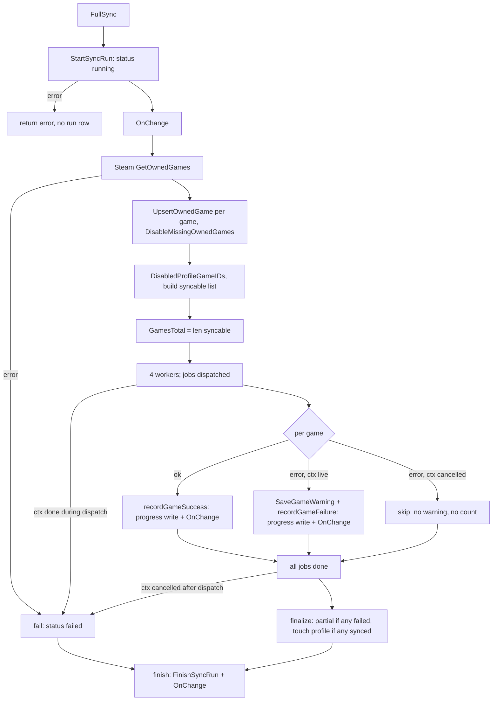
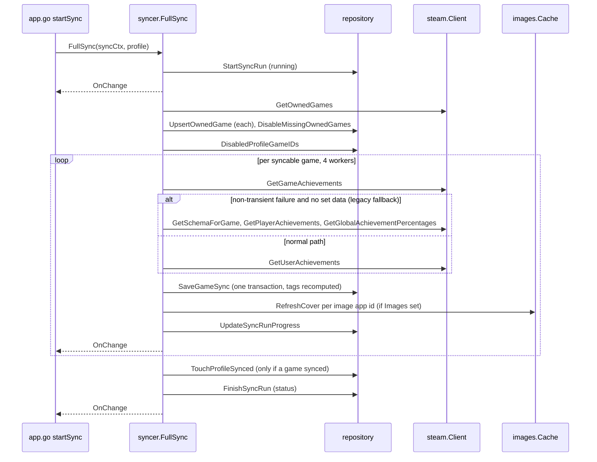

# Syncer (`internal/syncer`)

The syncer runs one full sync for a profile: it loads the profile's library from Steam, refreshes each syncable game's achievement sets, writes results through the repository, refreshes covers, and records the run status. Source: `internal/syncer/syncer.go`. Tests: `internal/syncer/*_test.go`.

The syncer does not own goroutines or cancellation. `app.go` (`startSync`) creates the context, starts `FullSync` in a goroutine, and wires notifications. See [app-service.md](app-service.md). The syncer's database reads and writes go through `internal/repository` (see [repository.md](repository.md) and [database.md](database.md)). Steam requests go through `internal/steam` (see [steam-client.md](steam-client.md)). Cover files go through `internal/images` (see [covers.md](covers.md)).

## Public API

```go
type Service struct {
    Repo   *repository.Repository
    Steam  *steam.Client
    Images *images.Cache   // nil disables cover refresh
    OnChange func()        // nil-safe; see Progress and change notifications
}

type Result struct {
    GamesTotal  int
    GamesSynced int
    GamesFailed int
    Status      string   // success, partial or failed (see Run statuses)
    Error       *string  // summary (partial) or error text (failed)
}

func (s *Service) FullSync(ctx context.Context, profile repository.Profile) (Result, error)
```

`FullSync` returns `(Result, error)`. The error is non-nil only when the run fails (or cannot start; see below); a partial run returns a nil error. The run row is written either way.

Everything else in the file is unexported. Exported values from other packages used here: `repository.Profile`, `steam.OwnedGame`, `steam.Client` methods, `images.Cache` methods.

## Run lifecycle



The same flow as a sequence, with the external calls:



`FullSync` steps:

1. `Repo.StartSyncRun` inserts a `sync_runs` row with status `running`. On error, `FullSync` returns immediately: no row, no `OnChange`, no status.
2. `OnChange` is called once the row exists.
3. `prepareOwnedGames`: `Steam.GetOwnedGames`, then `Repo.UpsertOwnedGame` for each game (playtime, purchased, vetted, name), then `Repo.DisableMissingOwnedGames`. Upsert and disable errors are logged and do not fail the run. A `GetOwnedGames` error fails the run and changes nothing else in the database.
4. `Repo.DisabledProfileGameIDs` lists apps to skip; `syncableGames` drops them. The run's `GamesTotal` is set to the size of the remaining list.
5. `syncGames` starts 4 worker goroutines (a literal `4` in `syncGames`), dispatches every syncable game on an unbuffered channel, closes the channel, and waits for the workers.
6. `finalize` sets status `partial` when any game failed, and calls `TouchProfileSynced` when at least one game succeeded.
7. `finish` writes the final status, error and counts with `Repo.FinishSyncRun`, then calls `OnChange`.

Failure of the whole run goes through `fail(err)`: status `failed`, the stored error text from `steam.UserMessage(err)` (a cancelled run stores `The request was canceled.`), then `finish`. The raw `err` is returned to the caller, which logs it.

`GamesTotal` reaches the row through `UpdateSyncRunProgress`, called after each game finishes, and through `FinishSyncRun`. Thus, `games_total` remains 0 while the first game is in progress and becomes visible only afterward. A run with no syncable games, or one that fails before any game finishes, gets its total only from `FinishSyncRun`.

## Run statuses

Status values stored in `sync_runs.status`:

| Status | Written by | Decided by |
| --- | --- | --- |
| `running` | `Repo.StartSyncRun` | Row created at start of `FullSync`. Stays until `FinishSyncRun`. |
| `success` | `finalize` (default) | No failed game and no run-level error. A run with zero syncable games is also `success`. |
| `partial` | `finalize` | At least one game failed (`GamesFailed > 0`), including when every game failed. `Error` reads `N of M games failed to sync`. |
| `failed` | `fail` | Run-level error: `GetOwnedGames` or the disabled-game lookup failed, or the context was cancelled during dispatch or after all games were dispatched. `Error` is `steam.UserMessage(err)`, which gives `The request was canceled.` on cancel. |
| `canceled` | `Repo.CancelRunningSyncRuns` at app start | Not written by the syncer. It marks rows still `running` after an unclean exit. |

A cancelled sync therefore ends as `failed`, not `canceled`. Games interrupted by cancellation are not counted and do not get warnings (see [Cancellation](#cancellation)).

If `FinishSyncRun` itself fails, the error is logged and the row stays `running`. The app then reports that run as `failed` with a stale-run message, without changing the row (see [app-service.md](app-service.md)).

## Worker pool and per-game failures

- Workers run `syncWorker`, which calls `syncGame` for each job. A nil error calls `recordGameSuccess`.
- A non-nil error when the context is still live calls `recordGameFailure`: it formats the warning (`repository.FormatGameError`) with the cause of the error (`usererr.LogText`, paths reduced) and logs it, calls `Repo.SaveGameWarning` with `steam.UserMessage(err)` (the user-safe sentence shown in Sync errors), increments `GamesFailed`, and writes progress.
- A non-nil error when the context is cancelled is neither a success nor a failure: no warning, no count. The game keeps its stored data.
- The mutex guards only the counters. `updateProgress` writes to the repository and calls `OnChange` outside the lock.

## Per-game refresh

`syncGame(ctx, profile, game)` refreshes one game. Each step below is in `internal/syncer/syncer.go`.

1. `Steam.GetGameAchievements(appID)`. On error:
   - `shouldFallbackToLegacy` decides whether to switch to the legacy path. It returns true only for an `*steam.HTTPStatusError` whose code is not transient (429, 500, 502, 503, 504 are transient), or for an `*steam.EResultError`. Transport, context and decode errors never fall back. Unrelated errors return `achievement schema: <err>`.
   - Fallback is refused when the game already has set data (`Repo.HasSetData`), because the legacy path writes one group-0 entry and prunes all others. In that case the error surfaces and existing entries are kept.
   - Otherwise `syncGameLegacy` runs: `GetSchemaForGame`, `GetPlayerAchievements`, `GetGlobalAchievementPercentages`, one group-0 entry from `buildAchievementStats`. Legacy code is marked for removal together with the legacy client methods. If `GetSchemaForGame` returns an empty list, `syncGameLegacy` calls `saveGameWithoutAchievements` (step 2).
2. If the schema has no achievements (EResult 42 or an empty list), `saveGameWithoutAchievements` writes the game as `no_achievements` with a group-0 entry only, then refreshes the game's cover.
3. `Steam.GetUserAchievements(steamID64, appID)`. Failure returns `user achievements: <err>`.
4. `buildSetEntries(appID, schema, user)` builds one `setEntry` per eligible set (see below).
5. `saveEntries` builds a `repository.SetSyncUpdate` per entry, comparing each against its previous state (`Repo.ProfileGame`), then calls `Repo.SaveGameSync` in one transaction, then refreshes the covers of the game and its entries' image ids.

Entries may be empty (the game has achievements but none is eligible). That is written as-is: every entry of the game is deleted (see [Set eligibility](#set-eligibility-and-entries)).

### What `SaveGameSync` writes

One transaction in `internal/repository/games.go`, per successful game:

- `games` row (name, `has_achievements`, `achievement_status` `ok` or `no_achievements`);
- `profile_owned_games` playtime (purchased and vetted are left as set by `UpsertOwnedGame`);
- prunes this profile's `profile_achievements` for the app that are not in the new set list, and the app's `achievements` that are not in it and that no profile still references (all of them when the list is empty);
- `game_sets` (name, DLC id, order) per set. Rows are only upserted: a set Steam stops reporting keeps its row (see [Surprising behaviour](#surprising-behaviour));
- `achievements` and `profile_achievements` per set;
- prunes `profile_games` entries (and their `profile_game_tags`) whose groupid is no longer eligible; flags and snapshots are kept;
- `profile_games` entry per set, with totals, completion, score and the completion flags;
- one `game_snapshots` row per set (history);
- tag recomputation per set (`recomputeGameTagsTx`).

## Set eligibility and entries

`buildSetEntries` takes the schema (`steam.GameAchievements`) and the user state (`steam.UserAchievements`):

- Achievements are grouped by `GroupID`. `withDefaultSets` adds a default set (public, no DLC, no name) for each groupid that has achievements but no `Sets` metadata. Default sets follow the Steam sets, in ascending groupid order.
- Sets are walked in schema order. Only a set that passes `setEligible` marks its groupid as seen, so the first eligible set wins for duplicates. An eligible set with no countable achievement still marks its groupid seen, so a later duplicate is skipped too.

| Rule | Effect |
| --- | --- |
| `set.Archived` | Set skipped (`setEligible`). |
| `set.DeveloperOnly` | Set skipped. |
| `!set.Public` | Set skipped. |
| No non-archived achievement in the set | Set skipped (`buildSetEntry` returns no entry). |
| `set.DLCAppID != 0` | Image id is the DLC id; otherwise the game id. |
| DLC not owned (`dlcNotOwned`) | Entry kept, flagged `DLCNotOwned`. The set's groupid is non-zero, `DLCAppID` is non-zero, the groupid is absent from `user.Groups`, and no achievement in the set is unlocked. |

DLC ownership is inferred, not read directly. The profile owns a DLC set when Steam lists its groupid in the user response or any of its achievements is unlocked. A DLC set that is not owned is kept, so it can show the `dlc_not_owned` tag. Once owned, the next sync clears the flag.

Each entry records every achievement, including archived ones (for the record). Only non-archived achievements count toward totals and completion.

## Completion, score and flags

For each entry (`buildSetEntry`, `statsTally`, `setSyncUpdate`):

- `total` = non-archived achievements; `unlocked` = non-archived achievements the profile has unlocked.
- `completion` = `unlocked / total * 100`, or 0 when total is 0.
- `missingAvg` = mean of `GlobalPercent` over non-archived locked achievements that have a global percent; nil when none does.
- `isCompleted` = `total > 0 && unlocked == total`. Locked archived achievements never block completion.
- `score` (`suggestionScore`) = `completion * 0.5 + missingAvg * 0.5`, or `completion * 0.5` when `missingAvg` is nil. Stored in `profile_games.suggestion_score` on the achievement path. On the no-achievements path it is left NULL.

The repository repeats the same formula in `suggestionScoreOrFallback`, used only when a stored score is NULL. The two must be kept in step.

The "was" and "newly incomplete" flags (`wasEverCompleted`, `wasEverCompletedNow`, `newlyIncomplete`):

- `was_completed` = previously `was_completed`, or previously `is_completed`, or the manual "previously completed" flag, or `isCompleted` now.
- `newly_incomplete` is true when the entry is not complete now and either:
  - it was `newly_incomplete` before, or the manual "previously completed" flag is set; or
  - it existed before, had been completed (`was_completed` or `is_completed`), and the total now exceeds the stored `total_achievements` (new achievements were added).
- Once the entry completes again, `newly_incomplete` clears. The "new achievements" branch needs a stored previous row, so a first sync never sets it.
- `saveGameWithoutAchievements` (the no-achievements path) sets `was_completed` from the previous state, but `newly_incomplete` only from the manual flag (`prev.ManualWasCompleted`). The new-achievements branch is not evaluated there, so a `newly_incomplete` flag from an earlier sync is cleared when the game turns `no_achievements`.

`repository.MarkGamePreviouslyCompleted` also sets these flags directly from snapshots and manual flags when the user acts on a card.

### Tag computation hooks

The syncer does not compute tags. `repository` does, in `recomputeGameTagsTx` (`internal/repository/tags.go`), and it runs inside the same transaction as the write that triggers it:

- `SaveGameSync`: once per set, after the entry and snapshot are written.
- `SaveGameWarning`: once per existing group (or the placeholder group 0), after the warning is written.
- `SaveCover` (`Repo.SaveCover`): for every entry whose owning image id (`imageAppIDSQL`) equals the saved id, plus every entry of the game with that id as its app id (`entriesForImageApp`), once per cover save. `saveEntries` and `saveGameWithoutAchievements` save covers after `SaveGameSync`, so this is the only write that clears `missing_cover_art` when a cover arrives. Without it the tag would stay until the next game sync.
- User actions in the repository: `MarkGamePreviouslyCompleted`, `ToggleMissingAchievementsInDLC` and `EnableProfileGame` recompute the tags. `DisableProfileGame` deletes the entry's tags instead.

Thresholds and rules that matter for sync results (verified in `internal/repository/repository.go` and `tags.go`):

- `almost_there` when a started, incomplete entry has a score of at least 40 (`almostThereThreshold`). Otherwise `in_progress`. "Started" is decided by playtime (`playtime_forever > 0`), not by unlocked count.
- `untouched` when playtime is 0 or less.
- `no_achievements` when `total == 0` or the game reports no achievements.
- `completed` when `is_completed`. For a DLC set not owned, no progress tags apply (`dlc_not_owned` returns early).
- `new_achievements_added`, `missing_achievements_in_dlc` only on incomplete entries.
- `missing_cover_art` when no cover path is resolved (`effectiveCoverAppIDSQL`).
- `sync_warning` when the latest sync failed for the entry.

## Disabled games and "no longer owned"

- `DisabledProfileGameIDs` returns app ids that have a disabled flag (entry-level or `not_owned`) and no entry left enabled. An app with at least one enabled entry stays in the sync, so its enabled sets keep updating.
- Apps in that list are removed before the workers start and are not counted in `GamesTotal`. A game whose sets are all disabled is therefore not refreshed, which means new DLC sets are only discovered after one of its sets is re-enabled.
- `DisableMissingOwnedGames` runs after every successful `GetOwnedGames`. For each entry of a game the profile no longer owns it sets `disabled=1` with reason `not_owned`. A `manual` disable keeps its reason, so re-owning a game does not re-enable it. A `not_owned` flag is cleared when the game is owned again. Tags of absent games are deleted.
- An empty owned list disables every entry of the profile as `not_owned`. `steam.Client.GetOwnedGames` accepts an explicit `game_count` of 0 as a valid empty library, so an empty answer from Steam has this effect.

## Failure handling

| Failure | Result |
| --- | --- |
| `GetOwnedGames` error | Run `failed`. No game rows changed. |
| Upsert or not-owned sweep error | Logged. Sync continues. |
| Game schema error (non-fallback) | Game `SaveGameWarning` with the user-safe text from `steam.UserMessage`. |
| Game user-achievement error | Same as above. |
| Legacy fallback with existing set data | Refused; game warning. Existing entries kept. |
| Store or cover error | Logged by the cover refresh. Game sync still succeeds. |
| `SaveGameSync` error | Game warning; the transaction is rolled back, so the previous data stays. |

Stored and displayed error text is always user-safe. `recordGameFailure` stores `steam.UserMessage(err)` as the game warning, and `fail` stores `steam.UserMessage(err)` as the run error, so a database or filesystem error stores `Something went wrong. See the log file for details.`. `fail` has no special case for cancellation: `steam.UserMessage` gives `The request was canceled.` for `context.Canceled`, also inside a `*url.Error`. The raw error is only logged: a game line through `repository.FormatGameError` with the sentence and the cause (`usererr.LogText`, paths reduced), a run line in `app.go` (`full sync failed`) with the same, the other sync log lines (`upsert owned game`, `save game warning`, `update sync progress`, `finish sync run`, and so on) and a cover line through `redact.Paths`. Cover refresh errors are never stored. The `partial` run text `N of M games failed to sync` is built from counts, not from error text.

`SaveGameWarning` keeps prior data when the game has entries: it sets `sync_warning` and `last_error` on each existing entry, and does not change totals. If the game has no entries, it creates a group-0 placeholder with `sync_warning` only; this placeholder has no progress and produces no progress tags until a sync succeeds. It also upserts the owned-game row so the playtime is current.

A run that ends `partial` still updates `last_synced_at` for the profile when at least one game succeeded. A run where every game failed is `partial` with `games_synced` 0, and the profile's `last_synced_at` is not touched.

Per-game warnings are cleared by the next successful sync of that game (`SaveGameSync` writes `sync_warning` 0 for each entry it writes). The tests for this are `TestFullSyncClearsWarningAfterRecovery` and `TestFullSyncRecordsPartialFailureAndKeepsSuccessfulGame` in `syncer_test.go`.

## Cancellation

- The sync context is derived from the app lifetime context in `startSync`. Two app paths cancel a running sync: `ServiceShutdown` (cancels the lifetime context and the sync's cancel func) and `ClearActiveUserData` (calls `cancelSyncAndWait` before removing the profile). No other user action cancels a sync.
- `dispatchSyncJobs` stops handing out work when the context is done and returns `ctx.Err()`.
- A game interrupted by cancellation is not warned and not counted. Its stored data stays as it was. Steam requests honour the context, so workers stop quickly.
- After the workers finish, `syncGames` returns `ctx.Err()` when cancellation happened after the last job was handed off. Without this check, the run would end as `success`.
- Any cancellation makes the run `failed`, with the context error as its text.

## Progress and change notifications

`Service.OnChange` is called from the sync goroutine and the worker goroutines, so it must be goroutine-safe. It is never called while the run's mutex is held.

`OnChange` fires at:

1. after `StartSyncRun` succeeds, before the library fetch;
2. after every per-game result (`updateProgress`), whether or not the progress write succeeded;
3. after `FinishSyncRun` in `finish`, whether or not it succeeded.

It does not fire when `StartSyncRun` fails. The count tests (`syncer_changed_test.go`) pin this: for `N` games it fires `N + 2` times.

`app.go` sets `OnChange: a.emitSyncChanged`. Separately, `startSync` emits once before starting the goroutine, and `endSync` emits once after clearing the in-progress flag and before releasing the wait group. The frontend refetches app state on each `sync:changed` event (see [frontend.md](frontend.md)).

## Cover sync invocation

Covers are refreshed only after a game's data is written successfully, never for a failed game and never for a disabled or skipped one.

- `saveEntries` and `saveGameWithoutAchievements` call `refreshCovers` after `SaveGameSync` returns. The image ids are the game id plus each distinct DLC id among the new entries (`coverImageAppIDs`).
- `refreshCovers` does nothing when `Service.Images` is nil. Failures are logged; they never fail the game.
- `refreshCover` loads the stored cover row, calls `images.Cache.NeedsRefresh`, and stops when the cover is fresh (no request made).
- For a base game with a `CapsuleFilename`, `images.Cache.RefreshCover` is tried with the library file name from `GetOwnedGames`. If it returns no error and did not download, the store is asked. If it returns an error, `refreshCover` returns it without a store lookup.
- For a DLC id, or a base game without a capsule name, `images.Cache.StoreItemAssets` is asked first.
- The result is saved with `Repo.SaveCover` only when `RefreshCover` succeeds with a result that is not `Skipped`. On the capsule path, a result that did not download is not saved; the store lookup runs instead. When `RefreshCover` errors, returns `Skipped`, or the store lookup errors, nothing is saved (no cover row changes). Errors are logged.

The URL rules, the capsule chain and the freshness intervals are in [covers.md](covers.md).

## Surprising behaviour

Maintainers should know about these quirks in the current implementation.

- **An empty achievement schema wipes the game's entries.** `GetGameAchievements` with an `x-eresult` of 1 (or no header) and a body without achievements, such as `{"response":{}}`, is decoded as "no achievements". `syncGame` then takes the `saveGameWithoutAchievements` path, which deletes this profile's unlock rows for the game (`profile_achievements`), deletes the shared `achievements` rows of the game only where no profile references them, and deletes all of the game's entries except group 0. No warning is recorded. The same holds for an empty 2xx body. `GetOwnedGames` guards against this, `GetGameAchievements` does not.
- **An unusable user-achievement response reads as zero progress.** `GetUserAchievements` with `{"response":{}}` (EResult 1 or 42) returns no unlocks. Entries are then written with 0 unlocked achievements and are not warned.
- **Eligible-entry list empty is written, not skipped.** When a game has achievements but none is eligible, `saveEntries` writes an empty set list. All entries of the game are deleted and the game is `ok` with no entries.
- **Empty user groups mark DLC sets as not owned.** If `GetUserAchievements` returns no groups (`{"response":{}}`, or EResult 42), every DLC-bound set with no unlocked achievement is flagged `DLCNotOwned`, including sets the profile does not own and sets it does own. No warning is recorded.
- **Set rows are never pruned by sync, so legacy fallback can be refused for good.** `SaveGameSync` only upserts `game_sets`. Once an app has a non-zero groupid row there, `HasSetData` stays true. Only `ClearProfileData` removes those rows, and only when no profile still has `profile_games` rows for the app. Until then, a `GetGameAchievements` failure for that app is never retried through the legacy API.
- **`partial` covers total failure.** A run where every game failed is `partial`, not `failed`. Only run-level errors make it `failed`.
- **Counts appear late.** `games_total` is written with the first progress write, so the first game's progress is the first time the run shows a total.
- **Two copies of the score formula.** `syncer.suggestionScore` and `repository.suggestionScoreOrFallback` both use `0.5/0.5`. Change both together.
- **`In progress` depends on playtime.** The tag uses `playtime_forever > 0`. A game with playtime and no unlocked achievements is `in_progress`. The user guide describes the tag in the same terms, "the game has playtime", so the two agree; the tag is not based on unlocked achievements.

## Tests

| File | Covers |
| --- | --- |
| `syncer_test.go` | Full runs against a fake Steam server (`fakeSteamServer`): sets, DLC ownership, cover refresh, legacy fallback, cancellation, redaction, concurrency and progress. |
| `syncer_faults_test.go` | Injected repository write failures: logged, sync continues, counters persist. |
| `syncer_retry_test.go` | Retryable statuses from `GetGameAchievements`: success after retry, exhausted retries as partial without legacy fallback. Also a `GetOwnedGames` failure that keeps existing data. |
| `syncer_entries_test.go` | Pure functions: completed boundary, missing-average calculation, synthesized default sets. |
| `syncer_changed_test.go` | `OnChange` call count and nil safety. |

The fake server mirrors the Steam endpoints used by `internal/steam`. Retry backoff is set to zero. The image cache uses a transport that rewrites Steam and CDN hosts to the fake server. See [testing.md](testing.md).

## Related docs

- [architecture.md](architecture.md): where the syncer sits in the backend.
- [app-service.md](app-service.md): `startSync`, `endSync`, `sync:changed`, stale run handling.
- [repository.md](repository.md): the write methods the syncer calls.
- [database.md](database.md): `sync_runs`, `profile_games`, `game_snapshots` and related tables.
- [steam-client.md](steam-client.md): the Steam calls and their error types.
- [covers.md](covers.md): cover URLs, fallback chain, freshness.
- [frontend.md](frontend.md): how the UI consumes `sync:changed` and the run status.
- [testing.md](testing.md): test layout and fakes.
